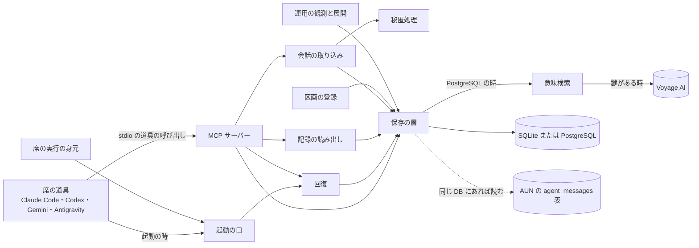
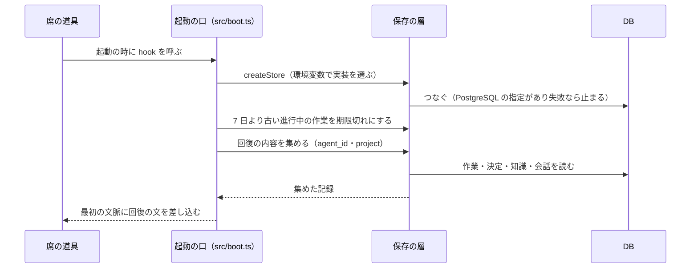
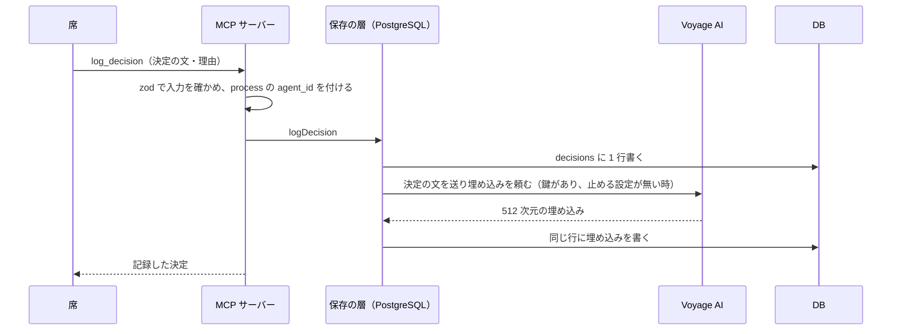
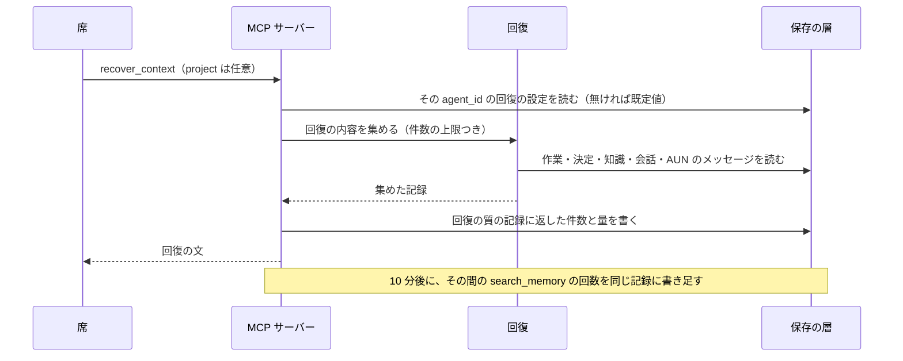

# 作りの全体 — Kusabi（agent-memory）

## Architecture Analysis

### System Overview

席ごとに 1 つ動く MCP サーバー（stdio）である。サーバーは起動の時に保存の層を 1 つ選び、17 個の道具を席に出す。席の種類ごとの起動の口（hook）が、席の起動の時に同じ保存の層から回復の内容を読み、席の最初の文脈に差し込む。

- 誰の記憶か（agent_id）と案件（project）は、process の環境変数 `AGENT_MEMORY_AGENT_ID`・`AGENT_MEMORY_PROJECT` で決まる（src/index.ts）。道具の呼び手は agent_id を渡せない。例外は set_recovery_config で、agent_id を引数で受ける（src/index.ts 666 行目付近）
- 記憶の境目は「agent_id ＋ 案件（任意）」（docs/design/core/SSOT-7_RUNTIME_AGENT_BINDING.md 第 3 節）

### Architectural Style

単一の process・単一のパッケージの作り（モノリス）。保存の層は差し替えの口（Store の interface、src/stores/types.ts 499 行目）の後ろに 3 つの実装を持つ。

| 実装 | 選ばれる条件（src/stores/index.ts） | 置き場所 |
|------|--------------------------------------|----------|
| SQLite（sql.js） | PostgreSQL の URL が無い時の既定 | `~/.agent-memory/memory.db`（`AGENT_MEMORY_DB_PATH` で変更） |
| PostgreSQL（pg） | `AGENT_MEMORY_DATABASE_URL` か `DATABASE_URL` が postgres で始まる | その URL の DB。つながらない時は SQLite に逃げず止まる |
| JSON | `AGENT_MEMORY_DB_TYPE=json` の時だけ（試験用） | `~/.agent-memory/` |

### Component Relationships

文字での説明: 席の道具は MCP サーバーの道具を stdio で呼び、起動の時は起動の口を通る。MCP サーバー・起動の口・回復・記録の読み出し・会話の取り込み・区画の登録・運用の観測と展開は、すべて保存の層を通して SQLite か PostgreSQL を読み書きする。会話の取り込みは保存の前に秘匿処理を通す。席の実行の身元は起動の口が使う。PostgreSQL の時だけ、保存の層は意味検索を通して Voyage AI に文を送り、埋め込みを作る（鍵がある時）。同じ DB に AUN の agent_messages 表があれば、保存の層はそれを読む。

### Data Flow

1. 書く: 席が道具を呼ぶ → zod で入力を確かめる → 保存の層が process の agent_id を付けて表に書く → PostgreSQL の時は、決定・作業の状態・知識の文を Voyage AI に送って埋め込み（512 次元）を同じ行に書く
2. 回復する: 起動の口か recover_context → その agent_id の回復の設定を読む（無ければ既定値）→ 進行中と完了の作業・有効な決定・知識・最近の会話・（あれば）AUN のメッセージを集める → 文にまとめて返す → 回復の質の記録（recovery_quality_log）に何件返したかを書く
3. 起動の時の掃除: Claude Code の起動の口（src/boot.ts）は、7 日より古い進行中の作業を期限切れにする
4. 取り込む: 手元の会話の記録（JSONL）を読み、伏せ字の処理をして conversation_events・raw_events に書く

表の一覧は component-inventory.md の「保存の層」、道具ごとの読み書きは api-documentation.md を参照。

### Key Design Decisions

- **記憶の持ち主は役割の名前（agent_id）**: 再起動や席の種類の交代（Codex から Claude Code へなど）でも agent_id が同じなら同じ記憶を読む。session_id を記憶の区切りにしない（SSOT-7 第 3 節）
- **PostgreSQL の指定があれば逃げない**: URL があるのにつながらない時、SQLite に切り替えずに止める（src/stores/index.ts）
- **DB の作りの変更は、何度流しても同じ結果になる前向きの変更だけ**（`IF NOT EXISTS` の形、src/stores/pg-migrations.ts）。戻す手順は無い
- **区画の登録は分からなければ非公開**: kusabi_agent_memory_partitions の登録が無い・壊れている時は、その席だけの非公開として扱う（src/kusabi-partitions.ts）
- **知識の範囲は席・案件・未分類の 3 つ**で、いつも agent_id の条件が付く（src/stores/knowledge-scope.ts）。席をまたいで知識を共有する形は無い
- **AUN とは互いに頼らない**: 両方入っていれば連携し、片方だけでも動く（CLAUDE.md）

### Improvement Opportunities

今回の取り組みの条件から見た、作りの上の足りない所（負債の詳細は code-quality-assessment.md）:

1. **別の役割の席への引き継ぎが無い**: SSOT-7 第 7 節は「受け取る側の agent_id に明示の引き継ぎの要約を置くか、将来の共有の引き継ぎ表」とするだけで、表も道具も無い
2. **顧客の層が無い**: SSOT-7 第 2 節の表で、顧客（利用者・組織）の層は「未実装、将来の固い境目」。今は agent_id と DB の分け方しか区切りが無い
3. **記憶の文が外へ出うる**: PostgreSQL の時、鍵があれば記憶の文が Voyage AI に送られる。「自社か顧客の DB の中で完結」と食い違う
4. **共通基盤の DB に分けて入れる作りでない**: 表は既定の場所（schema の指定なし）に作る。共通基盤の登録（席・主体）との結びつきも「計画中（#147）」（SSOT-7 第 6 節）
5. **汎用の DATABASE_URL も拾う**: 席の環境に別の製品用の DATABASE_URL があると、その DB に Kusabi の表を作りうる（src/stores/index.ts）

## Interaction Diagrams

### 席の起動と回復（Claude Code の起動の口）

文字での説明: 席の道具が起動の時に起動の口を呼ぶ。起動の口は環境変数で保存の層を選んで DB につなぎ（PostgreSQL の指定があってつながらなければ止まる）、7 日より古い進行中の作業を期限切れにしてから、その席の agent_id と案件の作業・決定・知識・会話を読み、回復の文として席の最初の文脈に差し込む。

### 決定を記録する（PostgreSQL の時）

文字での説明: 席が log_decision を呼ぶと、MCP サーバーは入力を確かめ、process の agent_id を付けて保存の層に渡す。PostgreSQL の保存の層は decisions に書き、Voyage AI の鍵があって止める設定（`AGENT_MEMORY_DISABLE_EMBEDDINGS=1`）が無ければ、決定の文を Voyage AI に送って埋め込みを作り、同じ行に書く。作業の状態と知識も同じ流れ。

### recover_context と回復の質の記録

文字での説明: 席が recover_context を呼ぶと、MCP サーバーはその agent_id の回復の設定（無ければ既定値）で件数の上限を決め、回復の部品が作業・決定・知識・会話・（あれば）AUN のメッセージを集める。返す前に、何をいくつ返したかを回復の質の記録に書き、10 分後にその間の search_memory の回数を書き足す。続きから仕事を続けたかどうかの印も、同じ記録に後から付く（src/recovery-quality.ts）。
