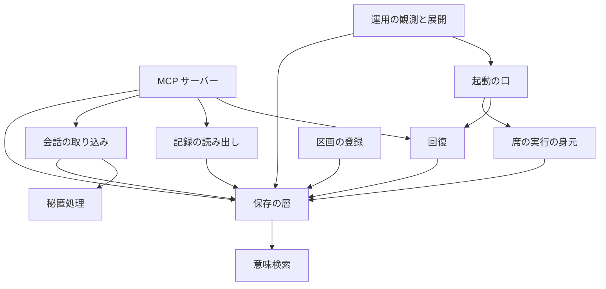

# 依存 — Kusabi（agent-memory）

## 外の依存

### npm のパッケージ

版の一覧は technology-stack.md を参照。動かす時に要るのは @modelcontextprotocol/sdk・pg・sql.js・ajv・ajv-formats・uuid の 6 つ（package.json の dependencies）。どれも範囲指定（`^`）で宣言し、実際の版は `package-lock.json`（lockfileVersion 3）で決まる。

### MCP SDK の下の依存（package-lock.json の解決、2026-11-09 の読み解き）

MCP SDK 1.28.0 は次の部品に依存し、どれも本番の依存（dev でない）として入る。本番の道のり（`server/mcp`・`server/stdio`）で使うのは stdio の部品だけで、HTTP 系の部品は本番の道のりから呼ばれない（HTTP の server は試験の中の `node:http` の fixture だけで、SDK の HTTP の部品は使っていない）。

| 部品 | lock の版 | 種類 |
|------|----------|------|
| express | 5.2.1 | HTTP |
| body-parser | 2.2.2 | HTTP |
| proxy-addr | 2.0.7 | HTTP |
| express-rate-limit | 8.3.1 | HTTP |
| router・path-to-regexp・send・serve-static・qs・cookie・raw-body・content-type・cors | 2.2.0・8.4.0・1.2.1・2.2.1・6.15.0・0.7.2・3.0.2・1.0.5・2.8.6 | HTTP |
| hono・@hono/node-server | 4.12.9・1.19.11 | HTTP |
| eventsource・jose・pkce-challenge | 3.0.7・6.2.2・5.0.1 | HTTP の認証・接続 |
| zod・zod-to-json-schema | 4.3.6・3.25.2 | 入力の形 |
| ajv・ajv-formats・fast-uri | 8.20.0・3.0.1・3.1.2 | JSON Schema |
| cross-spawn | 7.0.6 | stdio の子 process |

### 外のサービスと資源

| 先 | 種類 | 要るか | 中身 |
|----|------|--------|------|
| PostgreSQL（pgvector つき） | DB | PostgreSQL を選んだ時 | 記憶の表の置き場 |
| Voyage AI | 外の有料の API | 任意（鍵がある時だけ使う） | 記憶の文を送り埋め込みを受ける |
| `~/.agent-com-api-keys` | 手元の file | 任意 | Voyage AI の鍵の読み先（AUN と共用の file） |
| AUN の agent_messages 表 | 別の製品の表 | 任意 | 同じ DB にあれば回復の時に読む |
| 席の道具の手元の会話の記録（`~/.claude/projects/*.jsonl` など） | 手元の file | 会話の取り込みの時 | 読むだけ |

## 内部の依存

単一のパッケージで、パッケージ間の依存は無い。部品の間の向き:

文字での説明: MCP サーバーは回復・記録の読み出し・会話の取り込みを使う。起動の口は回復と席の実行の身元を使う。会話の取り込みは秘匿処理を使う。運用の観測と展開は起動の口を使う。これらはすべて保存の層を通して DB に触れ、保存の層は PostgreSQL の時に意味検索を使う。保存の層から上の部品への向きは無い。

## 依存の注意

- **zod の宣言が無い**: src/index.ts が直接読み込むが、package.json に無い。MCP SDK の依存として入っているだけなので、SDK の版が変わると壊れうる
- **宣言と実際の版の開き**: 範囲指定（`^`）のため、宣言（SDK ^1.12.1）と lock の版（1.28.0）が離れている。lock を作り直すと、宣言の範囲の中で版が動く
- **使わない HTTP の部品も本番の依存に入る**: MCP SDK が HTTP 系の部品（express・hono など）に依存するので、本番の道のりで使わなくても本番の依存に入り、それらの勧告の対象になる
- **汎用の DATABASE_URL を拾う**: `AGENT_MEMORY_DATABASE_URL` が無いと `DATABASE_URL` を使う。席の環境に別の製品の URL があると、その DB に Kusabi の表を作りうる
- **鍵の file を AUN と共用**: Voyage AI の鍵を `~/.agent-com-api-keys` から読むので、Kusabi の環境に鍵を置かなくても外への送り出しが起こりうる
