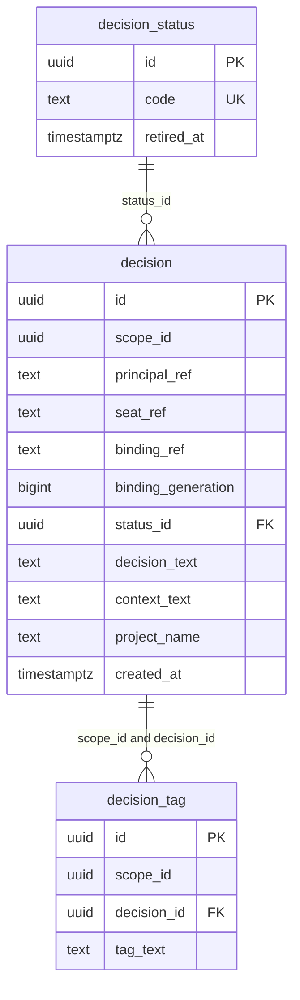

# U1 の DB の設計の記録 — 席の記憶の置き場（`kusabi` の置き場）

- 単位: U1 u1-seat-memory-skeleton（取り組み 261021-facility-ax-memory）
- 守る物: DB の構造・権限（`escalation-policy.md`、`protected-surface-owner-gate.md`）。この記録は、作る段の前に出す設計の記録だけの PR で、独立の設計監査を 1 回受ける（team.md）。本番への適用は Owner の決定（A8.5）。
- 正本: 社内の DB の基準 版 0.10（iyasaka-org `docs/shirube/db-standard.md`、commit `a48602d3fcf70a5b04a07cf70bcf6824ff259818`、file の SHA-256 `048c0062d0930756400b96c5539f1a7850924f454e17fe002c58a6791e655036`）。書く前に読み、読んだ版の SHA-256 がこの値と一致することを確かめた（2026-11-19）。
- 形: B1（入力の表 1〜3）と B3（出力の型 0〜8）。承認済みの記録（entities・rules・functional-spec・計画）は書き換えない。この記録が足す所と読み替える所は、§0 と §8 に書く。
- 前提の版（A1.1）: PostgreSQL（手元の使い捨ての DB。版の番号は公開の記録に書かない）。A8.4 の「その版の手順」を使う。
- 共通基盤の固定: onza の commit `7da9af914d0eb484ea8f7ae56e3d086798ee9995` の 0.3.1。席の確かめは `common.verify_current_tx`（7 引数）を黒箱として呼ぶ。5 file の SHA-256 は、その commit の bytes から計算した値（manifest の宣言値を写していない。S5）:

| file | SHA-256 |
|---|---|
| `common/0.2/sql/001_schema.sql` | `74a057518b680a8913c69eb3778cbdb8bc8fb4e0965a3ca83a1f84578c35846d` |
| `common/0.2/sql/010_verify_current_tx.sql` | `62aa83daa6a61eda84d125ed2c967a0644dd5665dbf72805e61ae9af16165346` |
| `common/0.2/sql/020_acl.sql` | `538277141a4bdf7c50c3f616a6641b8bf5e773896601e78553860506d02f18b2` |
| `common/0.3/sql/030_presence.sql` | `81f45d1028a488fa7ad07cf00abee3ca94067bb5c800471f37cfc374eaa11745` |
| `common/0.3.1/sql/031_presence_touch_state_only.sql` | `bcea4308f8731ade9c8ea028a011290f5ad7860251ccbc15fb4404546033c291` |

この記録は、共通基盤（onza。非公開の repo）の SQL の本文・内部の作り・契約の中身を写さず、要約もしない（計画 D6。公開の repo。arc の判断、決定 95 による委任、Owner の言葉ではない）。書くのは、Kusabi の code が呼ぶ時に公開の code にも出る物だけ: 関数の名前・引数の数・失敗の名前（OC001〜OC011）・Kusabi の側の role の名前・Kusabi の移行が付ける共通基盤の role の名前（`common_verify_caller`）と、固定した commit と 5 file の参照。それ以外は「共通基盤の契約（onza の固定 commit `7da9af9`、非公開）に従う」と書いて参照に留める。引いた arc の答えの言葉も、同じ形に狭めた。この形に収まらない行があれば、設計監査の項目 DS-2 の (d) で監査席が行を名指しで差し戻す。

- 状態: arc の確認（§0.6。arc の判断、決定 95 による委任。Owner の言葉ではない）を受けて書いた版に、1 回目の設計監査（org-auditor、head `a3b50ade`、PR #349 のコメント 6998218072、BLOCK。差し戻しは BF-01 の 1 件）を受けた直しを足した版。足した所は、§2.5 の席の確認の段（①′）・補助の関数・失敗の対応、§3.1（取り出しの道の全部の照らし）、§4 の 1 行目、§5 の 0002・§6 の権限の補助の関数、§8 の D-8、§9.2 の確かめ、§10 の T-1〜T-9。

---

## DB の節

### 0. 入力（B1 の表 1〜3）

#### 0.1 入力の不足と読み替え（arc へ）

| ID | 内容 | この記録の扱い |
|---|---|---|
| Q-V1 | 承認済みの記録（rules・functional-spec・差分の記録）は置き場所の設定を DB の接続の設定だけで書いている。共通基盤の確かめに渡す入力（先頭の 3 引数。意味と形は共通基盤の契約（onza の固定 commit `7da9af9`、非公開）に従う）の出どころが、記録に無い。席の設定 file に持ち、道具の引数にしない（引数で本人を名乗らせると他の席を名乗れるため）。Kusabi の code は時刻を自分で取らず、呼ぶ側が時計から渡す（S4） | DB の関数は確かめの先頭の 3 引数を受けるので、出どころが決まるまでは関数の形が変わらない（§2.5）。出どころの案: DL-3a で決めた user config（`database_url` と同じ場所）に `common_seat` の欄を持たせ、環境変数には出さない。値は配備（U9）が書き、値が古くて確かめが断った時は、BR2.5 で `binding_closed` になる（席の設定の更新が要る）。arc の答え（§0.6）: 案のとおり。計画の Step 4（`common-placement.ts`。1.1 の user config の読み）に `common_seat` の欄の読みを足し、失敗の文・記録に生の値を出さない試験を 1 つ足す。Step 4 の見込み（約 200 行）は増える（足す行数は実装で数える。計画の Step 1 は「挙動は足さない」ので、ここには足さない）（§10） |
| Q-R1 | 計画 1.3 は「関数は持ち主の権限（`kusabi_owner`）で動く」と書く。表の持ち主に関数を持たせるのは A9.4 の外れの例に当たる | 関数の持ち主を専用の role に分ける（§6）。arc の答え（§0.6）: 案のとおり。さらに、読むだけの関数（`get_decisions`・`recover_decisions`）の持ち主は `SELECT` だけにする（保存用 `kusabi_save_function_owner` と取り出し用 `kusabi_query_function_owner` の 2 つ）。計画の文は承認済みなので書き換えず、この記録で読み替える（実装の段の記録に 1 行残す） |
| Q-R2 | 計画は「up/down の SQL 1 対」と書く。A8.6 は、role の移行と表の移行を分ける | 2 対にする（`0001` role、`0002` 表）。拡張の移行は無い（PostgreSQL の組み込みの関数だけを使う） |
| Q-C1 | id の版の CHECK。B2.6 の 3 は、分割する表の id に版の CHECK を要求する。分けない表には要求が無い | `decision`・`decision_tag` の id にも `CHECK ((uuid_extract_version(id) = 7) IS TRUE)` を付ける案（A3.2 の UUIDv7 の既定を DB でも見張る。`IS TRUE` までが規格の形）。採らなかった代替 = 付けない（呼ぶ側の作り方だけを信じる）。arc の答え（§0.6）: 付ける |
| Q-R3 | 承認済みの entities.md の `status`（active・superseded）と、書き換え不可の属性の決まり。置き換え（U2）の表し方が U1 の時点で決まっていない | U1 の表に `status_id`（参照の表）を持たせ、`active` の行だけを入れる。`superseded` の行と更新の道は U2 が足す（足す → 移す → 消す）。U1 の関数は決定を更新しない |

#### 0.2 入力の作り手が書く物（B1 の 3 つ。席の下書きを arc が確認した版。I-3・I-4 は仮置き）

| ID | 項目 | 下書きの値と出所 |
|---|---|---|
| I-1 | U1 で使わない項目（表に入れない） | 作業の状態・学び・会話の取り込み・置き換えの記録・冪等キー・presence・user config の権限の確かめ（計画 6 の持ち越し）。使う Unit の入力で足す |
| I-2 | 既にある移行が作った物 | 共通基盤の 5 file（上の表）。共通基盤の移行が作る物は、共通基盤の契約（onza の固定 commit `7da9af9`、非公開）に従い、この記録は書かない。`kusabi` の名前の置き場・role は作らない（5 file を grep で確かめた）。移行の role の名前と、`common_verify_caller` の ADMIN OPTION を持つ role は、配備の事実（U9・Owner の決定）。この記録では空欄 |
| I-3 | 長さ・数の上限 | **仮置き（出所なし）**。承認済みの記録（要件・機能設計・計画）にも、今の `log_decision`・`get_decisions` の入力の定義（main の `src/index.ts`。長さの上限なし）にも、上限は無い。値: `decision_text` 1〜8000 文字、`context_text` 1〜8000 文字、`project_name` 1〜200 文字、`tag_text` 1〜64 文字、1 つの決定の札は 20 まで、取り出しの件数は 1〜100。出所が引けた物は 2 つだけ: `get_decisions` の既定 10（今の道具の定義の `limit` の説明）と、回復の既定 3（今の `DEFAULT_RECOVERY_CONFIG.decisions_limit`、`src/constants.ts`）。8000 は別の道具 `read_memory_source` の `max_chars` の上限（読む側）に揃えた案で、決定の文の上限としての出所ではない。注意: 今の道具は上限なしで受けるので、新しい上限は「今まで受けた長い文を断る」変更になる（`MODE` の無い今の形は変わらない）。確かめる項目: build の試験で各上限と上限 + 1 の境界（通る・断る）。監査の項目にも入れる（§10） |
| I-4 | 量の見込み（表 1 の「量」） | 席の数と 1 日の件数は**仮置き（出所なし）**。席の数: 要件 AS7 の「数十」から 60 を選んだ（60 は案）。1 日の件数 20 は出所なし。今の Kusabi の決定の件数は、席が本番の保存先を読めないので観測していない（team.md の Deployment）。導き方: (b) = 60 席 × 20 件 × 365 日 = 438,000 行（1 年後）、(a) 最初に使う所 = 席 2 つ × 20 × 365 = 14,600 行（約 1.5 万）。§9 の測定は、(b) と同じ形の合成 438,001 行（60 席 × 7,300 行、1 つの所属範囲）で行った。見直しの目安: 量が見込みの 10 倍（約 440 万行）を超えたら分割を見直す（§5 の持ち越し・§7）。確かめる項目: 運用で実測の行数を観測し（B4-5 の定期の SQL）、見込みと比べる。監査の項目にも入れる（§10） |
| I-5 | 英語の名前 | 下の表 2・3 の「英語の名前」の欄 |
| I-6 | 席の記憶の持ち主 | 席（BR3.2）。製品や agent_id ではない（BR2.7） |
| I-7 | 表の種類の読み | 決定 = 物（状態が変わる表。U2 で `superseded` に移る）。出来事の表ではない（§7 B2.6-3） |
| I-8 | 関数の持ち主の分け方 | Q-R1 |
| I-9 | 移行の分け方 | Q-R2 |

I-1・I-2・I-5〜I-9 は、承認済みの記録（計画 6・BR3.2・BR2.7）と、固定した共通基盤の file から引けた物。I-3・I-4 は上のとおり仮置き（出所なし）で、確かめる項目と監査の項目に入れた。

#### 0.3 表 1: 取り出しの一覧

| ID | 誰が・どこで | 何を | 条件 | 並び | 量 | 頻度 | 速さの目標 | 過去の見方 |
|---|---|---|---|---|---|---|---|---|
| R-01 | 席の AI。道具 `get_decisions` | 決定の ID・`decision_text`・`context_text`・`project_name`・札（`tag_text` の一覧）・状態の `code`・作った時刻 | 確かめた所属範囲と同じ `scope_id`、確かめた席と同じ `seat_ref`、状態 = `active`。任意: `project_name` の等値、札のどれか 1 つに一致（any match） | `created_at` の新しい順、同時刻は `id` の新しい順 | 1 回に 1〜100 行（既定 10）。全体は (a) 約 1.5 万、(b) 約 44 万（1 年後）。1 席の 1 年は約 7,300 行 | (b) で 1 日 600 回（60 席 × 10 回の仮置き） | 100ms（既定）。道具の DB の処理全体は 5 秒の上限（計画 1.3） | 今の値（行は書き換えない。状態だけが U2 で変わる） |
| R-02 | 席の起動の口（Claude Code・Codex の SessionStart）。関数 `recover_decisions` | R-01 と同じ列と、その席の active の決定の総数（省いた件数を言うため。FR3.4） | R-01 の必須の条件 3 つ | R-01 と同じ | 1 回に 1〜100 行（既定 3。今の回復の既定 `decisions_limit`）。全体は R-01 と同じ | (b) で 1 日 120 回（60 席 × 2 回の仮置き） | 100ms。起動の口の全体は 7 秒の上限（NFR4） | 今の値 |

書き込み（W-01 `log_decision`）は取り出しではないので、この表に置かない。流れは §3 の下に書く。

#### 0.4 表 2: 物と出来事の一覧

| 名前 | 英語の名前 | 種類 | 誰のもの | 消し方 | 参照する相手 |
|---|---|---|---|---|---|
| 決定 | `decision` | 物 | 施設ごと（所属範囲 = 顧客） | 引退（状態。U2 で `superseded`）。通常運用に削除の経路を持たない（A7.1） | 状態（多 → 1）、札（1 → 多）。共通基盤の所属範囲・主体・席・割り当て（外部キーを張らず参照の値を持つ） |
| 決定の札 | `decision_tag` | 物（決定が持つ値の一覧） | 施設ごと | 親と同じ（足すだけ） | 決定（多 → 1） |
| 決定の状態 | `decision_status` | 選択肢 | 全体 | 引退（`retired_at`） | 決定から参照される（1 → 多） |

個人情報の列は無い。`decision_text`・`context_text` は席が書く開発上の決定の自由文で、個人情報を入れない運用とする（中身の検査は DB の範囲の外。決定表 6 の 1 行目に当たらない）。

#### 0.5 表 3: 後から変わる・増える物の一覧

| 何が | 英語の名前 | 誰が変える | いつ | 検索に使うか |
|---|---|---|---|---|
| 決定の状態の値（`active`・`superseded`） | `decision_status` の行 | 自社 | 開発時（U2 で `superseded` を足す） | 使う（R-01・R-02 の条件） |
| 決定の札 | `decision_tag.tag_text` | 席 | 運用中（決定ごとに増える） | 使う（R-01 の条件） |
| プロジェクトの名前 | `decision.project_name` | 席 | 運用中（決定ごとの値） | 使う（R-01 の条件） |
| 所属範囲・主体・席・割り当て・世代の参照 | `scope_id`・`principal_ref`・`seat_ref`・`binding_ref`・`binding_generation` | 共通基盤（この製品の外） | 運用中（確かめた時点の値を写す） | 使う（`scope_id`・`seat_ref`） |

#### 0.6 arc の答え（arc の判断、決定 95 による委任。Owner の言葉ではない）

arc から席への連絡で受けた。その後、arc がこの答えを GitHub（iyasaka-arc#49 のコメント 6998022804。本文の SHA-256 `0b8012e5156a1a771c101a08ea3f3229b71590e22d455ef44b81002165a44e21`）に公開した（`authority-and-waiting.md` の R1）。席は、公開された本文の SHA-256 がこの値と一致すること、下の表が書き写す答えの ID（Q-V1・Q-R1・B2.6・Q-C1・I-1〜I-9）の語が本文にあることを確かめた。本文にはこのほかに DL-1・DL-2・DL-3a・NFR-1・NFR-2・計画の 1〜6 の答えがあり、この表には写していない。下の表の写しは、公開された本文を席が自分の言葉で書いた物で、本文そのものではない。DB の構造は守る物なので、この PR は設計監査の後、R3 以上の扱いで arc が Owner の exact-head を取る。下の表の答えは、その exact-head が出るまでの間の arc の判断として使う。

| ID | arc の答え | この記録での反映 |
|---|---|---|
| Q-V1 | 案のとおり。置き場所の入力（確かめの先頭の 3 引数の値）は、席の user config の `common_seat` の欄から読む（環境変数・道具の引数にしない）。Kusabi の code は時刻を自分で取らず、注入された時計から渡す。生の値が失敗の文・記録に出ない試験を足す | §0.1 Q-V1、§10 |
| Q-R1 | 案のとおり、専用の NOLOGIN の持ち主に分ける。さらに、読むだけの関数の持ち主を `SELECT` だけにする案を検討し、結果を 1 行書く | 保存用 `kusabi_save_function_owner`・取り出し用 `kusabi_query_function_owner` の 2 つに分けた（§6）。結果の 1 行は D-3（§8）、確かめは §9.1 |
| B2.6 | 決定を「状態が変わる物」と読み、分割しない（約 44 万行）。読みと量を deviation_ledger に書き、量が見込みの 10 倍を超えたら見直す持ち越しを書く | D-7（§8）、§5・§7 の持ち越し |
| Q-C1 | 版 7 の CHECK を、分割しない 2 つの表（`decision`・`decision_tag`）に付ける | §2.2・§2.3 の CHECK、§0.1 |
| I-1〜I-9 | 出所のある項目は出所つきで残す。I-3・I-4 は、導けなければ「仮置き（出所なし）」と書き、build の試験と監査の項目に入れる | I-3・I-4 を書き直し（出所のある 2 つ = `get_decisions` の既定 10・回復の既定 3、残りは仮置き）、§10 に入れた。前の下書きの出所（「検索の上限 100」「原文の取り出しの上限 8000」「回復の既定 20」）は誤りだったので外した |

### 1. ER 図（Mermaid）

共通基盤の表は図に描かない。Kusabi の表からは外部キーを張らず、確かめた時点の値を持つだけにする（§8 の D-1・D-2）。

### 2. 表ごとの定義

置き場はすべて `kusabi`。entities.md の `scope_ref` は列 `scope_id` に、`decision` の属性名 `decision`・`context`・`project` は `decision_text`・`context_text`・`project_name` に当たる。

| 表 | 置き場 | 誰のもの | 消し方 | 個人情報 |
|---|---|---|---|---|
| `decision_status` | `kusabi` | 全体 | 引退（`retired_at`） | なし |
| `decision` | `kusabi` | 施設ごと（`scope_id`） | 引退（状態）。削除の経路なし | なし |
| `decision_tag` | `kusabi` | 施設ごと（`scope_id`） | 足すだけ。削除の経路なし | なし |

#### 2.1 `kusabi.decision_status`（参照の表。A5.6）

| 列 | 型 | NOT NULL | 既定 | 説明 |
|---|---|---|---|---|
| `id` | uuid | はい | なし | 主キー。移行の中の固定の値（UUIDv7）を入れる |
| `code` | text | はい | なし | `active`。U2 で `superseded` を足す |
| `retired_at` | timestamptz | いいえ | NULL | 空 = 使っている（A5.1: 引退の列は空を許す） |

- 主キー `pk_decision_status (id)`。`unique_decision_status_code (code)`。
- `check_decision_status_code_shape`: `code ~ '^[a-z][a-z0-9_]*$' AND length(code) <= 64`。
- 行: `active` の 1 行だけ（U1）。
- 施設の列を持たない（全体のデータ。A6.1）。RLS を掛けない。

#### 2.2 `kusabi.decision`

| 列 | 型 | NOT NULL | 説明 |
|---|---|---|---|
| `id` | uuid | はい | 主キー。UUIDv7 を呼ぶ側が作って渡す（A3.2・S4） |
| `scope_id` | uuid | はい | 施設の列（A6.1）。確かめの結果の所属範囲から入れる（BR2.6）。外部キーを張らない（D-2） |
| `principal_ref` | text | はい | 確かめの結果の主体。外部キーを張らない参照（A2.3） |
| `seat_ref` | text | はい | 確かめの結果の席。持ち主（BR3.2） |
| `binding_ref` | text | はい | 確かめの結果の割り当て |
| `binding_generation` | bigint | はい | 確かめの結果の世代 |
| `status_id` | uuid | はい | 状態。U1 は `active` の行の `id` だけ |
| `decision_text` | text | はい | 決定の文 |
| `context_text` | text | いいえ | 理由。道具の引数が任意なので空を許す（A5.1 の理由） |
| `project_name` | text | いいえ | プロジェクトの名前。道具の引数が任意なので空を許す |
| `created_at` | timestamptz | はい | 確かめの結果の観測した時刻から入れる（DB の時計。呼ぶ側の時計ではない）。精度の指定をしない（A4.1） |

- 主キー `pk_decision (id)`。
- 外部キー: `fk_decision_status_id_decision_status (status_id)` → `kusabi.decision_status (id)`、`ON DELETE RESTRICT`。
- 一意: `unique_decision_scope_id_and_id (scope_id, id)`（`decision_tag` が施設の列を含む複合の外部キーで指すため。A6.4）。
- CHECK（長さと形の値は I-3）:
  - `check_decision_id_shape`: `(uuid_extract_version(id) = 7) IS TRUE`。
  - `check_decision_principal_ref_shape`・`check_decision_seat_ref_shape`・`check_decision_binding_ref_shape`: `principal_ref`・`seat_ref`・`binding_ref` の 3 列の形を見張る `CHECK`（Kusabi 自身の制約）。形の定義は、共通基盤の契約（onza の固定 commit `7da9af9`、非公開）に従い、この記録には書かない。実装の段の SQL に置き、負例の試験で、形の違う値と空の値を断ることを見る。
  - `check_decision_binding_generation_range`: `binding_generation >= 1 AND binding_generation <= 9007199254740991`。
  - `check_decision_decision_text_length`: `length(decision_text) >= 1 AND length(decision_text) <= 8000`。
  - `check_decision_context_text_length`: `context_text IS NULL OR (length(context_text) >= 1 AND length(context_text) <= 8000)`。
  - `check_decision_project_name_length`: `project_name IS NULL OR (length(project_name) >= 1 AND length(project_name) <= 200)`。
- index（どの取り出しのためか）:
  - `index_decision_on_scope_id_and_seat_ref_and_created_at_and_id (scope_id, seat_ref, created_at DESC, id DESC)` — R-01・R-02（条件と並び）。
  - `index_decision_on_status_id (status_id)` — 決定表 5b の 2 行目（外部キーの列。使う取り出しは無い）。
- RLS: `ENABLE` と `FORCE`。`policy_decision_scope` を `kusabi_save_function_owner` と `kusabi_query_function_owner` に付け、`USING` と同じ式の `WITH CHECK` は `scope_id = current_setting('kusabi.scope_id')::uuid`（2 つ目の引数を付けない。A6.2）。値は関数が確かめの後に `set_config('kusabi.scope_id', <確かめた所属範囲>, true)` で入れる。
- trigger: `trigger_decision_guard`（関数も同じ名前。`BEFORE UPDATE OR DELETE`）。DELETE は拒む。UPDATE は `status_id` 以外の列が変わる時に拒む（BR3.1: 保存の後に書き換えない。権限でも外すが、持ち主や移行の role に対する守りとして DB に持つ）。

#### 2.3 `kusabi.decision_tag`

| 列 | 型 | NOT NULL | 説明 |
|---|---|---|---|
| `id` | uuid | はい | 主キー。UUIDv7 を呼ぶ側が作って渡す |
| `scope_id` | uuid | はい | 施設の列。親の `scope_id` と同じ（複合の外部キーで縛る） |
| `decision_id` | uuid | はい | 親の決定 |
| `tag_text` | text | はい | 札の 1 つ分 |

- 主キー `pk_decision_tag (id)`。
- 外部キー: `fk_decision_tag_scope_id_and_decision_id_decision (scope_id, decision_id)` → `kusabi.decision (scope_id, id)`、`ON DELETE RESTRICT`（A5.3。削除の経路が無いので CASCADE は使わない）。
- 一意: `unique_decision_tag_scope_id_and_decision_id_and_tag_text (scope_id, decision_id, tag_text)`（決定表 2 の 7 行目。順は持たず、返す時は `tag_text` の昇順）。外部キーの列を先頭に持つので、外部キーの index を兼ねる（決定表 5b の 2 行目）。
- CHECK: `check_decision_tag_id_shape`（`decision` と同じ式）、`check_decision_tag_tag_text_length`（1〜64 文字）。
- RLS: `ENABLE` と `FORCE`。`policy_decision_tag_scope`（`decision` と同じ式）。
- trigger: `trigger_decision_tag_guard`（UPDATE と DELETE をすべて拒む）。

### 2.5 関数（置き場 `kusabi`。3 つは `SECURITY DEFINER`、補助の関数 1 つは `SECURITY INVOKER`）

3 つとも、`SET search_path = pg_catalog, kusabi, pg_temp`、作る移行の中で `REVOKE ALL ON FUNCTION … FROM PUBLIC` し、`kusabi_seat` にだけ `GRANT EXECUTE`（A9.2）。持ち主は、保存する `log_decision` が `kusabi_save_function_owner`（`SELECT`・`INSERT`）、読むだけの `get_decisions`・`recover_decisions` が `kusabi_query_function_owner`（`SELECT` だけ）。1 回の呼出しは 1 つの取引（呼ぶ側が `BEGIN` と時間の上限の設定をする。確かめと書き込みを同じ取引に置く。BR3.3）。関数は誤りを捕まえず、そのまま上へ出す（取引全体が戻る）。

共通の入力（3 つの先頭）: Kusabi の関数の先頭の 3 引数 `p_verify_context json`・`p_scope_id text`・`p_expected_actor json` は、確かめの先頭の 3 引数にそのまま渡す（意味と形は共通基盤の契約（onza の固定 commit `7da9af9`、非公開）に従う）。出どころは Q-V1。確かめの残りの 4 引数は、Kusabi の側が関数ごとに固定の値を渡す（値は共通基盤の契約（onza の固定 commit `7da9af9`、非公開）に従って実装の段で決め、そこで試験する）。

| 関数 | 追加の引数 | 返り値（jsonb） |
|---|---|---|
| `kusabi.log_decision` | `p_decision_id uuid`、`p_decision_text text`、`p_context_text text`、`p_project_name text`、`p_tag_ids uuid[]`、`p_tag_texts text[]`（引数の配列は輸送の形。表には持たない） | `decision_id`、`created_at_ms` |
| `kusabi.get_decisions` | `p_project_name text`、`p_tag_texts text[]`、`p_limit integer` | `decisions`（R-01 の列の配列）、確かめた席の参照 |
| `kusabi.recover_decisions` | `p_limit integer` | `decisions`、`total_active_count`、確かめた席の参照 |

- 共通基盤の関数は schema 名つき（`common.verify_current_tx`）で呼ぶ。`search_path` に `common` を入れない（A9.2）。
- 流れ（`log_decision`）: ① 確かめを呼ぶ（失敗は共通基盤の SQLSTATE `OC001`〜`OC011` のまま上へ）。①′ 席の確認の段（下）。② `set_config('kusabi.scope_id', <確かめた所属範囲>, true)`（A6.2。取引ごと）。③ `status_id` を `code = 'active'` で引く。④ 札の数が 20 を超える、または `p_tag_ids` と `p_tag_texts` の長さが違えば、標準の SQLSTATE `22023`（メッセージ `kusabi:invalid_input`）で止める。⑤ `decision` に 1 行、`decision_tag` に札の数だけ入れる。形・長さ・NULL・重複は、表の制約が `23514`・`23502`・`23505` で断る（同じ決まりを関数に写さない。S3）。確かめの結果に席が無い時は、①′ が先に止める（`seat_ref` の `NOT NULL` は 2 重目の守りで残す。成功に読み替えない。S8）。⑥ `decision_id` と `created_at_ms` を返す。
- 流れ（`get_decisions`・`recover_decisions`）: 確かめ（残りの 4 引数は関数ごとの固定の値）→ ①′ → ② → R-01 / R-02 の SQL。件数が 1〜100 の外なら `22023`。
- 席の確認の段（①′。BF-01。1 回目の設計監査 = PR #349 のコメント 6998218072）: 確かめが成功しても、確かめの結果が有効な席を持つとは限らない（監査の反例: 席に結ばれていない主体のままの接続で確かめが成功し、席・割り当て・世代が空で返った）。作者の読み: 取り出しの条件 `seat_ref = <空>` は 0 行になるので、席が無いことが、記録が無いことと同じ見え方になる。承認済みの規則は、有効な席（所属範囲・主体・席・割り当て・世代がそろう。BR2.1）だけに読み書きを許し、登録の無い席は `seat_not_registered`（BR2.2）、有効な割り当てが無ければ `binding_closed`（BR2.4）と定めている。この規則を DB の境に置く段が ①′ で、3 つの関数が、確かめの直後・② の前（設定・検索・書き込みの前）に、次の補助の関数を 1 回呼ぶ。席が空の呼出しを、空の一覧・総数 0・回復の成功に読み替えない（S5・S8）。成功の空（記録が無い）は、有効な席で記録が 0 件の時だけ。
- 補助の関数 `kusabi.require_verified_seat(p_seat_ref text, p_binding_ref text, p_binding_generation bigint)`（返り値なし。`SECURITY INVOKER`。`SET search_path = pg_catalog`。表にも共通基盤にも触れない）: `p_seat_ref` が空（`NULL` か空の文字列）なら、SQLSTATE `28000`・メッセージ `kusabi:seat_not_registered` で止める。席があり `p_binding_ref` か `p_binding_generation` が空なら、`28000`・`kusabi:binding_closed` で止める。どちらでもなければ何もせず戻る。判定と 2 つのメッセージは、この 1 か所だけが持つ（S3）。持ち主は `kusabi_query_function_owner`（表の持ち主に関数を持たせない。A6.3・A9.1。`SECURITY INVOKER` で表に触れないので、権限は広がらない）。`PUBLIC` から `EXECUTE` を外し、`kusabi_save_function_owner` に `EXECUTE` を付ける。`kusabi_seat` には付けない（席は直接呼ばない）。形（UUID の形）の確認は表の `CHECK` が持ち、補助の関数には書かない（S3）。
- 席の確認の段の失敗の対応: 計画の `common-seat-errors`（DL-4。失敗の名前を 1 か所だけに持つ表）に 2 行足す（計画の文は書き換えず、この記録で読み替える。D-8）。SQLSTATE `28000` + メッセージ `kusabi:seat_not_registered` → 失敗の名前 `seat_not_registered`、`28000` + `kusabi:binding_closed` → `binding_closed`（道具 `log_decision`・`get_decisions` が返す名前。BR2.5 が確かめの失敗の理由に当てる名前と同じ集合で、意味を足さない）。起動の口の回復（W4）: `seat_not_registered` は W4 の 4 のとおり `memory_status=not_registered`・決定は空・席の起動は続ける。`binding_closed` を回復の `memory_status` のどれに写すかは、承認済みの W4・`entities.md`・計画に書かれていない（確かめ自体の失敗 OC006〜OC008 でも同じ）ので、この記録では決めない。約束するのは「`ok` にしない・決定は空・席の起動は続ける」までで、写し先は実装の段の前に arc に確かめる（§10 の持ち越し）。対応表に無い SQLSTATE・メッセージは、成功に読み替えず、名前の無い失敗として返す（S8）。
- Kusabi 独自の SQLSTATE は作らない。失敗の SQLSTATE を Kusabi の失敗の名前（`invalid_input`・`store_refused` の理由ほか）に写す表は、計画の `common-seat-errors`（DL-4）が 1 か所に持つ（Step 4 で確定）。関数は共通基盤の理由を作り直さない（BR2.5・S2）。

### 3. 取り出しの対応表

| R-xx | SQL の形（JOIN する表） | 写しを使うか | EXPLAIN の結果 |
|---|---|---|---|
| R-01 | `decision` を `decision_status` と JOIN（`code = 'active'`）。条件 `scope_id`・`seat_ref`、任意で `project_name` の等値と `EXISTS (decision_tag …)`。札の一覧は `decision_tag` を決定ごとに `tag_text` 昇順で集める。`created_at DESC, id DESC` で `LIMIT` | 使わない（決定表 4a の 1 行目: 1 回の SQL で書ける） | 設計の段の予備の測定（§9）: 実行 0.28 ms（既定の 10 行）、1.46 ms（`project_name` と札の絞り込みつき）。index 走査で、`LIMIT` で止まる。実装の段（B4-4）で、同じ量の合成の行に対して 3 つ以上を測り直して書く（予備の測定は確かめの代わりにしない） |
| R-02 | R-01 と同じ条件の `decision` の行と、同じ条件の `count(*)`（総数） | 使わない | 設計の段の予備の測定（§9）: 実行 25 ms（1 席の 7,300 行を数える + 先頭 100 行）。実装の段（B4-4）で測り直す |

書き込み W-01: `decision` に 1 行と `decision_tag` に 0 行以上を、確かめた席の参照つきで 1 つの取引の中で入れる。

### 3.1 席の無い主体の穴の照らし（BF-01。取り出し・書き込みの道の全部）

1 回目の設計監査は、取り出しの道の 1 つで、確かめが成功するのに席が空という穴を見つけた。同じ形の穴が残る道が無いかを、取り出し・書き込みの道の全部について 1 回で照らした（この記録と、承認済みの機能設計・規則から。実装は未着手）。

| 道 | 確かめを呼ぶ | 席・割り当て・世代の確認 | 空の時の結果 | 有効な席で記録が 0 件の時 | 負例・対の試験（§10） |
|---|---|---|---|---|---|
| `log_decision`（書く。W-01） | はい | ①′。さらに `seat_ref`・`binding_ref`・`binding_generation` の `NOT NULL`（2 重目） | 断る（`28000`）。行は増えない | — | T-3・T-4 |
| `get_decisions`（読む。R-01） | はい | ①′ | 断る。空の一覧で返さない | `decisions` が空で成功 | T-1・T-4・T-5 |
| `recover_decisions`（読む。R-01 + R-02 の `total_active_count`） | はい | ①′ | 断る。決定が空・総数 0 の成功で返さない。TS 側は `memory_status` を `ok` にしない | `decisions` が空・総数 0 で成功 | T-2・T-4・T-5・T-9 |
| 起動の口（W4。Claude Code・Codex）が回復を呼ぶ道 | `recover_decisions` を通す | 上の行 | `seat_not_registered` は `memory_status=not_registered`・決定は空・席の起動は続ける。`binding_closed` の写し先は §2.5 のとおり持ち越し（`ok` にしない） | `ok` | T-8・T-9 |
| 席の role が表を直接読む道 | 呼ばない | 席の role は表の権限が無い（§6） | 権限の誤り（0 行で返さない） | — | §9 の確かめ（席は表を直接読めない） |
| 表を引くが所属範囲の値を入れていない取引 | 呼ばない | RLS の式が `current_setting` を要る | 「設定が無い」誤りで止まる（0 行で返さない） | — | §9 の確かめ |
| 補助の関数を呼ばない 4 つ目の関数（将来足す物） | — | — | 呼び忘れが入りうる | — | T-7（`kusabi` の schema の `SECURITY DEFINER` の関数の全部が補助の関数を呼ぶことを、catalog の本体の文字列で数える。足切りで、拒否の動作の保証ではない。拒否の動作は関数ごとの負例 T-1〜T-3 が持つ。新しい関数を足す時は、同じ形の負例も足す） |
| U1 に無い道具（BR3.5。作業の状態・学び・会話の取り込みなど） | 呼ばない（DB に行かない） | — | `not_yet_available`。単独の形・今の表に逃げない | — | 実装の段の TS 側の試験（BR3.5） |

照らした結果:

- 穴の形は、3 つの関数に共通だった。保存の道（`log_decision`）は `seat_ref` の `NOT NULL` が偶然止め、取り出しの 2 つ（`get_decisions`・`recover_decisions`）は止まらない形だった（空の一覧・総数 0 で成功する）。同じ判定を 1 か所（補助の関数）に寄せ、3 つが呼ぶ。`NOT NULL` は 2 重目の守りとして残す。
- 所属範囲・主体が空の呼出し（BR2.1 の 5 つのうち、補助の関数が見ない 2 つ）: 所属範囲が空なら、② の設定に空の値が入り、RLS の式の uuid への変換が誤りで止まる見込みで、0 行の成功にはならない（設計の段では流していない。未確認。実装の段で、T-1 の接続の形に所属範囲が空・不正の形を足して確かめる）。主体は読む条件に使わず（読む条件は所属範囲と席の参照）、書く道では `principal_ref` の `NOT NULL` が断る。
- 世代の範囲（1〜9007199254740991）: 書く道は `CHECK` が断る。読む道は検索の条件に世代を使わないので、範囲の外の世代が来ても結果は席の記録のまま（空の一覧にはならない）。
- 照らしていない道: 今の単独の形（JSON・SQLite・PostgreSQL の store）の読み書きは U1 の対象外で、共通基盤の形の道具から呼ばない（BR3.5）。単独の形は変えない（S6）。実装の段の試験で、共通基盤の形の道がそこへ逃げないことを見る。
- 作者の読み（監査席の判断を仰ぐ）: 確かめが、空でない形の違う席の参照を成功で返すことは、共通基盤の契約（onza の固定 commit `7da9af9`、非公開）の外と読む。書く道は `CHECK` が断る。読む道は 0 行（空の一覧）になる。これを起こすには確かめの本体を書き換えられる role（共通基盤の持ち主）が要り、対象外の前提（すでに特権を取られている前提）に当たると読む。補助の関数は空だけを見て、形を二重に持たない（S3）。

### 4. 不整合の目録（B7 の 11 種）

| # | 種類 | 当たる／当たらない | どう防ぐ | どう確かめる |
|---|---|---|---|---|
| 1 | ありえない値・重複・宙に浮いた参照 | 当たる | 主キー・外部キー（状態・札から決定）・`UNIQUE`・`CHECK`・`NOT NULL`。共通基盤への参照は外部キーを張れない（D-2）が、値は同じ取引の確かめの結果から入る。共通基盤の側の行が宙に浮かないことは、共通基盤の契約（onza の固定 commit `7da9af9`、非公開）に従い、実装の段の通しの試験で確かめる。確かめの結果の席・割り当て・世代が空の呼出しは、補助の関数が書く前・読む前に断る（①′。BF-01） | 制約の負例の試験（空の決定・長すぎる文・形の違う参照・UUIDv7 でない id・重複した札）。席の確認の段の負例（T-1〜T-5・T-7。§10）。運用の検査（B4-5）は運用の段で作る（§5 の持ち越し） |
| 2 | 同時の更新の取り合い | 当たる | 同じ id の同時の書き込みは主キーで 1 件だけ成功する。確かめと書き込みを同じ取引に置くこと（BR3.3）が、失効と書き込みを直列にする条件で、直列になる仕組みは共通基盤の契約（onza の固定 commit `7da9af9`、非公開）に従う。U1 に「確かめてから書く」読み書きは無い | 同じ id を 2 接続で同時に書く試験 |
| 3 | 再送による二重 | 当たる | U1 は自動の再送をしない（計画 1.3）。同じ id の再送は主キーで拒まれ、新しい id の再送は別の決定になる。内容の指紋つきの冪等キーは U1 に入れない（D-4） | 同じ id の 2 回目が拒まれる試験。結果不明の時に新しい id で再送しないことは、TS 側の試験 |
| 4 | DB と外の仕組みのずれ | 当たらない | この関数は DB の行だけを書き、外へ通知しない。呼出しの記録（file）は診断用で正本ではない（BR5.1） | — |
| 5 | 写しや集計のずれ | 当たらない | 写し・集計表を置かない（§7 の 4a・4b）。`total_active_count` は呼ぶたびに数える | — |
| 6 | 時間がたって意味が変わる | 当たる | 決定は書き換えない。確かめた時点の席・割り当て・世代を行に写す（Snapshot。BR3.1）。割り当てが替わっても前の決定の参照は変わらない。状態だけが U2 で変わる | 割り当てを替えた後も前の決定の参照が変わらない試験 |
| 7 | 施設どうしで混ざる | 当たる | `scope_id`・RLS（`FORCE`）・複合の外部キー（A6.4）。施設の値は確かめの結果から決め、要求の値を信じない（A6.2） | 別の所属範囲の席が読めない試験。`kusabi.scope_id` を入れずに表を引くと誤りで止まる試験 |
| 8 | 変更の途中のずれ | 当たらない | 新しい置き場を足すだけで、既にある物を変えない・消さない・拒まない（S6）。同居の期間の宣言は要らない | 進める → 戻す → 進める、新旧の 2 版の同時の試験（旧 = まだ無い状態）は要らない |
| 9 | 決まった形の外の値（jsonb） | 当たらない | `jsonb` の列が無い。関数の引数は型のある配列と text | — |
| 10 | 消し方のずれ | 当たる | 削除の経路が無い（権限なし・trigger で拒む）。状態の引退は U2。個人情報の列は無い | 持ち主の role と関数の持ち主の 2 つの role で UPDATE・DELETE が拒まれる試験。取り出し用の持ち主は INSERT も拒まれる試験 |
| 11 | 防ぎきれなかった時 | 当たる | 運用の 3 層（猶予・restore の試験・継続的な検査）は運用の段（U9 と Operation）で決める。U1 は置き場所の切り替えの前に元へ戻す手順を一度試す（team.md Deployment） | 持ち越し（§5） |

### 5. 移行

置き場所: `sql/kusabi/`。番号つきで、進める物（`.up.sql`）と戻す物（`.down.sql`）を対で持つ（A8.1）。一度当てた移行を書き換えない（A8.3）。

| 番号 | 段（A8.6） | 進める | 戻す |
|---|---|---|---|
| なし | 1 拡張 | 新しく要る拡張は無い（`uuid_extract_version` は PostgreSQL の組み込み） | — |
| `0001_roles` | 2 role | 1 つの transaction で、`CREATE ROLE kusabi_owner NOLOGIN`・`kusabi_save_function_owner NOLOGIN`・`kusabi_query_function_owner NOLOGIN`・`kusabi_seat NOLOGIN`。関数の持ち主 2 つに `GRANT common_verify_caller`。3 つの持ち主の role を `GRANT … TO <移行の role>`（`SET ROLE` のため）。`GRANT CREATE ON DATABASE <DB> TO kusabi_owner`。付いたことを `has_database_privilege` で確かめ、付かなければ誤りで止める（transaction ごと戻り、role は残らない） | 逆の順: `REVOKE CREATE ON DATABASE`、関数の持ち主 2 つから `REVOKE common_verify_caller`、3 つの持ち主の role を `REVOKE … FROM <移行の role>`、`DROP ROLE`（4 つ）。`common_verify_caller` 自体は共通基盤の物で消さない |
| `0002_schema` | 3 表 | 1 つの transaction で（途中で止まれば、一時の `CREATE` も含めて全部戻る）、`SET ROLE kusabi_owner` の下で、schema `kusabi`・表 3 つ・index・trigger・policy を作り、`decision_status` に `active` の行を入れ、schema の `USAGE` と表の権限を §6 のとおりに付ける。関数を作るために、schema の `CREATE` を関数の持ち主 2 つに**一時的に**付ける。`SET ROLE kusabi_query_function_owner` の下で、補助の関数 `require_verified_seat`（`SECURITY INVOKER`）を 3 つの関数より先に作り、`REVOKE ALL … FROM PUBLIC` と `GRANT EXECUTE … TO kusabi_save_function_owner`（`kusabi_seat` には付けない）。`SET ROLE kusabi_save_function_owner` の下で `log_decision`、`SET ROLE kusabi_query_function_owner` の下で `get_decisions`・`recover_decisions` を作り、それぞれ同じ transaction で `REVOKE ALL … FROM PUBLIC` と `GRANT EXECUTE … TO kusabi_seat`。最後に `kusabi_owner` の下で、一時の `CREATE` を外す | 1 つの transaction で、作った物を依存の逆の順に名指しで消す（3 つの関数 → 補助の関数 → policy → trigger → 表 → schema）。`CASCADE` を使わない。`kusabi_owner` は schema の持ち主なので、他の role が持つ関数も消せる（§9 で確かめた） |

- 移行の role の名前（`<移行の role>`）と `<DB>` は、移行の SQL の引数（psql の変数）で受け、SQL に値を書かない（A9.3）。名前は配備の決定で決まる（I-2）。
- 同居の期間: 要らない（新しい置き場を足すだけ）。
- 試験（A8.1・A8.6）: 使い捨ての PostgreSQL で (a) role が無い所から 1 → 2 → 3 で進め、3 → 2 → 1 で戻し、もう一度進める。(b) role を先に作っておき 3 だけを 進める → 戻す → 進める（戻した後も role が残る）。(c) 負例: DB の持ち主でない `CREATEROLE` だけの role で 2 を当てると 3 が止まる（`0001` が 1 つの transaction なので role は残らない）。各段の後に `pg_roles`・`has_database_privilege`・表と policy の有無を読んで確かめる。(d)（作る前の移行が作った物を移す試験）は、移す物が無いので当てはまらない。(e) `0002` の途中の失敗（例: 2 つ目の関数の作成を壊す）で、一時の `CREATE`・schema・表・関数（補助の関数を含む）が残らないこと（設計の段では 0002 の進める・戻すの往復だけを確かめた。この負例は実装の段の試験。§10）。
- 持ち越し（運用の段）: 量が見込みの 10 倍（約 440 万行）を超えたら分割を見直す（§7。D-7）。不変条件の継続的な検査（B4-5。例: 決定の `seat_ref` と `scope_id` が共通基盤に有ること。共通基盤の表を読める role が実行し、読めなければ「観測できず」を返して成功に数えない。S5）、restore の試験、使い捨てでない DB への適用（Owner の決定）。

### 6. 権限（role と GRANT）

| role | 種類 | 持つ物 |
|---|---|---|
| `kusabi_owner` | NOLOGIN | schema `kusabi`・表 3 つ・index・trigger の持ち主。表を作る移行だけで使う（`SET ROLE`）。接続しない |
| `kusabi_save_function_owner` | NOLOGIN | 保存の関数 `log_decision` の持ち主。`kusabi` の schema の `USAGE`。`decision`・`decision_tag` の `SELECT`・`INSERT`。`decision_status` の `SELECT`。共通基盤の確かめの `EXECUTE`（`common_verify_caller` の member として）。補助の関数 `require_verified_seat` の `EXECUTE`。`UPDATE`・`DELETE`・`TRUNCATE`・DDL・共通基盤の表の読み書きは持たない |
| `kusabi_query_function_owner` | NOLOGIN | 読むだけの関数 `get_decisions`・`recover_decisions` と、補助の関数 `require_verified_seat`（`SECURITY INVOKER`。表に触れない）の持ち主。`kusabi` の schema の `USAGE`。3 つの表の `SELECT` だけ（`INSERT`・`UPDATE`・`DELETE` は持たない）。共通基盤の確かめの `EXECUTE`（`common_verify_caller` の member として）。共通基盤の表の読み書きは持たない |
| `kusabi_seat` | NOLOGIN | `kusabi` の schema の `USAGE` と関数 3 つの `EXECUTE` だけ（補助の関数には付けない）。表の権限なし |
| 席ごとの DB の利用者（LOGIN） | 配備が作る | `kusabi_seat` の member。共通基盤の側の対応づけは共通基盤の契約（onza の固定 commit `7da9af9`、非公開）に従う。LOGIN と資格情報は起動の設定の時に Owner の決定で付ける（A8.6）。この移行は作らない |

- `PUBLIC` の権限は外す（schema `kusabi`、3 つの関数と補助の関数）。表は持ち主以外に `GRANT` しない。
- 席の DB の利用者での確かめの扱いは、共通基盤の契約（onza の固定 commit `7da9af9`、非公開）に従う。Kusabi の関数が `SECURITY DEFINER` でも席の DB の利用者での確かめが通るかは、共通基盤の 5 file を実際に当てた確認を設計の段でしていない（§9）。実装の段の使い捨ての PostgreSQL の試験（共通基盤の 5 file を当てる）で確かめ、席の利用者でない role では確かめが断られる負例を持つ（§5 の試験に加える）。
- 確かめを呼べる権限の付け方は、共通基盤の契約（onza の固定 commit `7da9af9`、非公開）に従う。Kusabi の側は、関数の持ち主 2 つを `common_verify_caller` の member にする（§5 の 0001）。`GRANT common_verify_caller TO` 関数の持ち主 2 つを実行する role は、その role に対する ADMIN OPTION を持つ必要があり、誰が持つかは配備の事実（I-2）。
- 表の持ち主 `kusabi_owner` は関数を持たず、関数の持ち主 2 つは表の持ち主ではない（A6.3・A9.1）。RLS は関数の持ち主 2 つに効く（policy の `TO` に 2 つを書く）。読むだけの関数が取り出し用の持ち主に分かれるので、取り出しの関数の中の誤りや注入で表に書く道が、権限の段で閉じる（§9 で確かめた。arc の勧めの読み、§0.6）。

### 7. 決定表の適用の記録

| 表 | 単位 | 当たった行 |
|---|---|---|
| 決定表 1 | `decision_text`・`decision_tag` の `tag_text` ほかの値 | 原文の行（1 行目）は当たらない（自社の応答の本文を持たない）。`status_id` は 2 行目（選択肢）→ 参照の表 + 外部キー。`project_name`・`decision_text`・`context_text`・各 `*_ref`・`binding_generation`・`created_at` は 5 行目 → 列（検索や制約を DB で宣言する値）。`jsonb` に当たる値は無い（3・4 行目なし） |
| 決定表 1 の前提 | 作れる値 | 決定の「当時の席」は確かめの結果そのもので他の列から作れないので持つ。`status` の `active` は列 `status_id` で持つ。ほかの表から作れる値は持たない |
| 決定表 2 | 決定と状態 | 1 行目（種類が違う）→ 別の表。2 行目（1 対多）→ 外部キー |
| 決定表 2 | 決定と札 | 7 行目（同じ種類の値の一覧）→ 子の表 `decision_tag`（配列型を使わない）。順を持たないので `(施設, 親の id, 値)` の一意 |
| 決定表 2 | 個人情報・施設と全体 | 5 行目は当たらない。6 行目: 状態の表は全体、決定と札は施設ごと（分ける） |
| 決定表 3a・3b・3c | jsonb | 当たらない（jsonb の列が無い） |
| 決定表 4a | R-01・R-02 | 1 行目 → 写しを置かない |
| 決定表 4b | 集計 | 2 行目 → 取り出しの SQL の中で数える |
| 決定表 5a | 主キー | 3 つの表とも 2 行目 → `id uuid`（v7、呼ぶ側が渡す） |
| 決定表 5b | index | 2 行目: `decision.status_id` の index（`decision_tag` の外部キーの列は一意が兼ねる）。3 行目: R-01・R-02 の複合の index。1・4・5・6 行目は当たらない（並び番号・順・jsonb は無い。履歴の表でもない） |
| 決定表 6 | 消し方・履歴 | 3 行目（参照される物）→ 引退。決定は状態で引退させ、通常運用に削除の経路を持たない。状態の表は `retired_at`。4 行目: 当時の値を写す（席・割り当て・世代の参照）。1・2・5〜7 行目は当たらない |

B2.6 の判断（理由つき。独立の監査で見る）:

1. 集約の境目: 決定と、その札を 1 つの集約にし、確かめと書き込みと札を 1 つの取引にする。札だけを別の取引で足す道は作らない（決定と札は一体で意味を持つ。BR3.3）。
2. 写しの境目: 速さの目標（100ms）に近い取り出しは無い。R-01 は 1 席 1 年で約 7,300 行を `(scope_id, seat_ref, created_at, id)` の index で引き、`LIMIT` で止める。結合は決定表 4a の境目にしない。実装の段で B4-4 の EXPLAIN により確かめ直す。
3. 分割の入れ方: 決定は「物」（状態が変わる。U2 の置き換えで `superseded` になる）で、「足しも直しもする表」の行に当たる。(b) の量は約 44 万行（1 年後）で、見込みの目安（1 表 1 千万行）より小さく、R-01 は 1 席の範囲を index で引く。代表の取り出しが 100ms を超える見込みは無いので、**分けない**。
   - (i) 分ける条件と観測: R-01 の EXPLAIN（B4-4）が 100ms を超える見込みになった時。運用では、`decision` の行数と R-01 の実測を B4-5 の定期の SQL で見る（運用の段で作る）。
   - (ii) 後から分ける時の作り直し: 普通の表を分割した表に変えられないので、新しい分割した表を作って写す。主キーは `(id, created_at)` に変わり、`decision_tag` の外部キーは `(scope_id, decision_id, decision_created_at)` に変わる。時刻の列を含まない一意は、今は無い。後から足す冪等キー（D-4）は、決まりのとおり分けない鍵の表に置く。
   - (iii) 今のうちに分割の列を主キーへ含めるか: 含めない。`created_at` は DB の時計から入る列で、id の時刻と同じ値にする縛り（`uuid_v7_time`）が要り、分けない表には余計になる。後の作り直しは (ii) のとおり表の作り直しと写しになる（受け入れる）。量が見込みの 10 倍（約 440 万行）を超えたら、この分けない判断を見直す（運用で行数を観測する。§5 の持ち越し・D-7）。
   - 行の種類の読み（I-7）: arc の答え（§0.6）は、決定を「状態が変わる物」と読み、分けない。決定を「足すだけの表」と読む代替（月ごとの分割）は採らなかった（D-7）。

### 8. deviation_ledger（規格から外れた所と、読み替えた所）

| ID | 項目 | 採った判断 | 採らなかった代替 | 後の PR の監査で見る項目（A9.4 の外れのみ） |
|---|---|---|---|---|
| D-1 | A2.3・A2.5 | 共通基盤の ID（`principal_ref`・`seat_ref`・`binding_ref`）を、同じ DB の別の製品の置き場にある物として、外部キーを張らず `text` の `*_ref`（形の CHECK つき）で持つ。製品をまたぐ読み書きは共通基盤の関数だけを通す決まり（A2.5）と、確かめた時点の値を写す決まり（BR3.1）による | 共通基盤の表への外部キー（表への `REFERENCES` の権限が要り、置き場をまたぐ結合になる） | — |
| D-2 | A2.3・A5.2・A6.1 | 施設の列は `scope_id uuid` とし、外部キーを張らない。A2.3 は施設の列の名前を変えないと書く。値は確かめの結果から入る | `scope_ref` に改名して `text` で持つ（A6.1 の「製品ごとに名前を 1 つ」と RLS の `::uuid` の式から外れる） | — |
| D-3 | 計画 1.3（関数の持ち主） | 表の持ち主 `kusabi_owner` と関数の持ち主を分け、さらに関数の持ち主を保存用 `kusabi_save_function_owner`（`SELECT`・`INSERT`）と取り出し用 `kusabi_query_function_owner`（`SELECT` だけ）に分ける（Q-R1。arc の答え、§0.6）。A9.4 の外れを作らない。やったこと 1 行: 3 つの関数を 2 つの持ち主に割り当て、取り出し用の持ち主が表に書けないことを使い捨ての PostgreSQL で確かめた（§9）。席の確認の補助の関数（D-8）は取り出し用の持ち主が持つ | 表の持ち主に関数を持たせる（計画の文。外れの行と監査の項目が要る）。持ち主を 1 つにする（取り出しの関数にも `INSERT` の権限が付く） | — |
| D-8 | 1 回目の設計監査の差し戻し BF-01（席の確認の段）と、計画の `common-seat-errors` | 席が空の確かめの結果を断る段 ①′ を、補助の関数 1 つ `require_verified_seat` に置き、3 つの関数が確かめの直後に呼ぶ。失敗の対応（`28000` + メッセージ 2 つ → `seat_not_registered`・`binding_closed`）を、計画の `common-seat-errors` に足す（計画の文は書き換えず、この記録で読み替え、実装の段の記録に 1 行残す）。やったこと 1 行: 取り出し・書き込みの道の全部を 1 回で照らした（§3.1） | 3 つの関数のそれぞれに同じ判定を書く（同じ判定とメッセージが 3 か所に出る。S3。関数が 3 つそろった今が S2 の 3 例目にあたるので、共通にした）。`seat_ref` の `NOT NULL` だけに頼る（`log_decision` だけが止まり、取り出しの 2 つは空の一覧になる = 失敗が成功に見える。S5・S8）。取り出しで席が空なら空の一覧を返す（承認済みの BR2.2 に反する） | — |
| D-4 | A10.1・S7 | `log_decision` の冪等キー（内容の指紋つきの再送の判定）は U1 に入れない。再送は自動でしない（計画 1.3）。同じ id の再送は主キーで拒まれ、結果不明の時は新しい id で再送せず、照会で確かめる。後の単位の持ち越し（計画 6）。冪等キーを入れる時は、行が分割されていないので `decision` に列を足す | 指紋つきの冪等キーを U1 に入れる（列と衝突の確かめが増え、U1 の「薄い一本」を超える） | — |
| D-5 | 計画の「up/down 1 対」 | 2 対にする（A8.6） | 1 対にまとめる（role と表の戻しの順が崩れる） | — |
| D-6 | 計画 1.3 の `status` | `decision_status` の参照の表を持ち、U1 は `active` の 1 行だけ（Q-R3）。entities.md の `status` を残す | `status` の列を U1 で持たない（承認済みの BR3.4 と W2 の文面から外れる） | — |
| D-7 | B2.6 の 3・I-7 | 決定を「状態が変わる物」（U2 で `superseded` に移る）と読み、分割しない（arc の答え、§0.6）。量は約 44 万行（1 年後、仮置き。I-4）で、R-01 は 1 席の範囲を index で引く（§3 の予備の測定は 438,001 行で 1.46 ms）。量が見込みの 10 倍（約 440 万行）を超えたら見直す（観測は運用の段。§5 の持ち越し）。分けない時の 3 点は §7 の (i)〜(iii) | 決定を「足すだけの表」と読み、月ごとの分割にする（主キーと外部キーに時刻の列が入り、U2 の状態の更新と合わない。最初から分割した表の手順が要る） | — |

A9.4 の外れは無い（関数の持ち主を分けたため）。上の外れ・読み替えのうち D-3・D-7 は arc の答え（§0.6）を受けた物。残りの理由は、足りなければ設計監査が指摘する。

### 9. 設計の段の予備の確かめ（実装の確かめの代わりではない）

設計の定義が PostgreSQL で作れて意図どおり断ることを、コードを書く前に確かめた（2026-11-19）。使い捨ての PostgreSQL（loopback だけで待ち、socket を作らず、既定でない port）に、§2 の表・制約・index・RLS・trigger・表の権限をそのまま作り、合成の行だけを入れた。§2.5 の関数（3 つと補助の関数 1 つ）は作っていない。共通基盤の SQL は当てていない（確かめの関数は呼んでいない。席の DB の利用者での確かめが通ること・`common_verify_caller` の継承・確かめと書き込みを同じ取引に置いた時の振る舞い（BR3.3）は未確認で、実装の段の試験の対象）。試験の script は記録に入れない（実装の段で `src/test-common-seat-pg.ts` に作る）。終わった後、DB と作業の folder は止めて消した。

| 確かめ | 結果 |
|---|---|
| §2 の DDL が通る。`uuid_extract_version` は PostgreSQL にある | 通った（版 7 の id で 7 を返す） |
| 施設の値が設定されていない取引で表を引く（A6.2） | 「設定が無い」誤りで止まる（0 行で返さない） |
| 施設の値と違う `scope_id` の行を入れる | RLS の誤りで断る |
| 別の施設の設定で引く | 0 行 |
| 空の `decision_text`・版 7 でない id・形の違う `*_ref`・世代 0・席の参照が NULL | それぞれの制約の名前つきの誤りで断る |
| 同じ札の再登録・同じ決定 id の再送 | 一意・主キーの誤りで断る |
| 別の施設の決定を指す札（RLS を素通りする role で試した） | 複合の外部キーの誤りで断る |
| RLS を素通りする role（superuser）で `UPDATE`・`DELETE` | trigger が断る（決定の `status_id` 以外の変更・決定の削除・札の変更）。`status_id` だけの更新は通る（U2 のため） |
| 関数の持ち主 2 つの role の `UPDATE`・`DELETE` の権限 | 持たない（保存用に `UPDATE` を試すと「表への権限なし」の誤り）。席の role は表を直接読めず（誤り）、schema の `USAGE` は `kusabi_seat` にだけ付く（無関係の role と `PUBLIC` は付かない） |
| 表の持ち主の role（FORCE RLS・自分に policy が無い） | 0 行 |
| R-01・R-02 の量 | 合成 438,001 行（60 席 × 7,300 行、札つき）。表 401 MB・札 82 MB。実行は §3 のとおり（0.28 ms・1.46 ms・25 ms）。すべて既存の index を使い、全件の走査は無かった |

予備の測定は、1 つの所属範囲に全部の行を置いた最悪に近い形（施設の分け方の効果を見込まない）。実機・本番の配備での値ではない。

#### 9.1 role の分割の予備の確かめ（2026-11-19）

arc の答え（§0.6）の role の分割を、別の使い捨ての PostgreSQL（loopback だけ・socket なし・既定でない port・`lc_messages=C`）で確かめた。**関数は §2.5 の本体ではなく、持ち主・権限・`search_path`・`SECURITY DEFINER` の形だけを持つ代わりの関数 2 つ**（保存側 1 つ・取り出し側 1 つ）。共通基盤の SQL は当てていない（`common_verify_caller` は同名の空の role を置いた）。表は §2 の DDL。移行の SQL は、この確かめの scratch に作った 2 対で、記録にも repo にも入れない（実装の段で `sql/kusabi/` に作る）。補助の関数 `require_verified_seat`（BF-01 の直し）は、この 9.1 の確かめには含めず、9.2 で別に確かめた。

| 確かめ | 結果 |
|---|---|
| `0001`・`0002` を移行の role（CREATEROLE・DB の持ち主・`common_verify_caller` の ADMIN OPTION あり）で進める | 通った。role 4 つ・schema 1 つ。関数の持ち主は保存側・取り出し側の role、`SECURITY DEFINER`、`search_path = pg_catalog, kusabi, pg_temp` |
| 関数を作った後、schema の `CREATE` | 2 つの関数の持ち主とも持たない（一時の `CREATE` を外した） |
| `PUBLIC` と無関係の role の `EXECUTE` | 無い。`kusabi_seat` だけが 2 つの関数を実行できる |
| `kusabi_seat` として代わりの関数を呼ぶ | 保存側は 1 行を書き、取り出し側は RLS の下で 1 行を読めた（取り出し用の持ち主が `SELECT` できる） |
| 取り出し用の持ち主で `decision_tag` に `INSERT` | 「表への権限なし」の誤りで断る |
| 保存用の持ち主で `decision` を `UPDATE` | 「表への権限なし」の誤りで断る |
| `kusabi_seat` で表を直接 `SELECT` | 断る。無関係の role は schema の `USAGE` が無く、関数も表も断る |
| 戻し（`0002` の down → `0001` の down）を進めた後に | role 0・schema 0。もう一度進め・もう一度戻して同じ（up → down → up → down） |
| 負例（c）: DB の持ち主でない `CREATEROLE` だけの role で `0001` を当てる | 警告「何も付かなかった」の後、`kusabi:owner_cannot_create` の誤りで止まり、`0001` が 1 つの transaction なので role は 0 のまま |
| 戻しの間に `kusabi_owner`（schema の持ち主）が他の role の関数を消せるか | 消せた（A8.6 の戻しは `kusabi_owner` の下で通る） |

見つけて直したこと: 最初の通しで、保存用の持ち主に `decision_status` の `SELECT` が無く、保存の関数が断られた（§6 の保存用の持ち物に入れてある）。最初の `0001` は transaction で包んでおらず、負例（c）で role が 4 つ残ったので、1 つの transaction にした。

未確認（実装の段）: 共通基盤の SQL を当てた、席の DB の利用者での確かめが通ること・`common_verify_caller` の継承・確かめと書き込みを同じ取引に置いた時の振る舞い（BR3.3）、`GRANT common_verify_caller TO <持ち主>` を実行する role が ADMIN OPTION を持つ配備の事実、席ごとの LOGIN の role と資格情報（配備・Owner の決定）。

後片付け: この確かめの PostgreSQL は止め、データの folder（47,636 KB）は消した。待ち受けは 0。

#### 9.2 席の確認の補助の関数の予備の確かめ（BF-01。2026-11-19）

§2.5 の補助の関数 `require_verified_seat` を、別の使い捨ての PostgreSQL（loopback だけ・socket なし・既定でない port・`lc_messages=C`）に作り、確かめた。**3 つの関数の本体ではなく、補助の関数を呼ぶ代わりの関数 2 つ**（`log_decision` 相当・`get_decisions` 相当）を使った。代わりの関数は、確かめの結果を引数で受け、補助の関数を ② の `set_config` の前に呼ぶ。共通基盤の SQL は当てていない（`common_verify_caller` は同名の空の role）。`recover_decisions` 相当は作っていない。表は §2 の DDL、role は `0001` と同じ。移行の SQL は、この確かめの scratch に作った物で、記録にも repo にも入れない。

| 確かめ（試験の ID） | 結果 |
|---|---|
| 補助の関数を直接呼ぶ（T-4）: 席が `NULL`、席が空の文字列 | どちらも SQLSTATE `28000`・`kusabi:seat_not_registered` |
| 同: 席があり、割り当てが `NULL`／世代が `NULL` | どちらも `28000`・`kusabi:binding_closed` |
| 同: 3 つがそろう | 通る（何も返さない） |
| 権限（T-6） | 持ち主は `kusabi_query_function_owner`・`SECURITY DEFINER` でない・`search_path = pg_catalog`。`EXECUTE` は持ち主と `kusabi_save_function_owner` だけ。`kusabi_seat` で直接呼ぶと「関数の権限なし」、無関係の role は「schema の権限なし」で断る |
| 席の role から代わりの関数を呼ぶ（取り出し相当・保存相当。T-1・T-3 の形） | 席が空は `kusabi:seat_not_registered`、割り当てか世代が空は `kusabi:binding_closed` で断る。取り出し相当は空の一覧を返さなかった |
| 対（T-5 の形）: 有効な席で記録が 0 件の取り出し相当 | 成功（`n = 0`）。保存相当で 1 行書いた後は `n = 1` |
| 断った呼出しが書いた行 | 0（表に残ったのは対の保存の 1 行だけ） |
| catalog（T-7 の形）: `kusabi` の schema の `SECURITY DEFINER` の関数の全部（この確かめでは 2 つ）が、本体で補助の関数を呼び、呼びが `set_config` より前にある | 2 つとも真 |
| 戻し: 代わりの関数 2 つ → 補助の関数の順に `kusabi_owner` の下で消す（0002 の down の順に合わせた） | 通った（残る関数は 0） |

見つけて直したこと: なし。この確かめは、補助の関数の置き方（持ち主・権限・呼ぶ順）が §2.5・§6 のとおりに動くことだけを見ている。共通基盤の確かめを実際に通した形（T-1〜T-3）、`recover_decisions`、TS 側（T-8・T-9）は実装の段に残る。

後片付け: この確かめの PostgreSQL は止め、データの folder は消した。待ち受けは 0。

### 10. 実装の段の確かめる項目と、監査の項目（この記録から持ち越す物）

実装の段（設計監査の PASS の後）で試験に入れる項目:

- `common_seat` の欄を読む読み手（user config）の試験: 欄が無い・形が違う・値が空の時の失敗の名前。生の値（所属範囲・席の参照・DB の利用者の資格情報）が失敗の文・呼出しの記録に出ないこと（負の確かめ。計画 Step 4 の `common-placement.ts` に足す）。Kusabi の code は時刻を自分で取らず、呼ぶ側の注入された時計から渡す（S4）。
- I-3 の仮置きの境界: `decision_text`・`context_text`（1〜8000）、`project_name`（1〜200）、`tag_text`（1〜64）、1 つの決定の札（20）、取り出しの件数（1〜100）の、上限と上限 + 1、下限と下限 − 1 で、通る・断る。
- role の分割: 取り出し用の持ち主が表に書けないこと、保存用の持ち主が `UPDATE`・`DELETE` できないこと、`kusabi_seat` が表を直接読めないこと、`PUBLIC` と無関係の role が関数を実行できないこと。
- id の版の CHECK（Q-C1）: 版 7 でない id を `decision`・`decision_tag` に入れると断ること。
- `0002` の途中の失敗の負例（§5 の試験 (e)）: 一時の `CREATE` が関数の持ち主に残らず、schema・表・関数が残らないこと。
- 上限の値の持ち主（S3）: 長さ・札の数・件数の上限は DB の `CHECK` が持つ。TS 側の入力検査が同じ値を別に書くなら、2 か所に同じ値が出る（S3 の機械検査が指す形）。実装の段で、(a) DB の `CHECK` だけを持ち、TS 側は `CHECK` の違反（SQLSTATE `23514`）を `invalid_input` に写す、(b) TS 側にも持ち、2 つの値が同じことを試験で突き合わせる、のどちらかを選び、理由を実装の記録に書く。
- 席の確認の段（①′。BF-01）の試験。3 つに分ける。T-1〜T-3・T-5 は、確かめを通すので、共通基盤の SQL（固定した commit の 5 file）を当てた使い捨ての DB。T-4・T-6・T-7 は、`kusabi` の schema だけの使い捨ての DB（補助の関数と catalog を見る）。T-8・T-9 は TS 側:
  - T-1: 席に結ばれていない主体のままの接続（確かめは成功し、席・割り当て・世代が空）で `get_decisions` を呼ぶと、`28000`・`kusabi:seat_not_registered` で断り、空の一覧を返さない。同じ接続の形で、所属範囲が空・不正の場合も、0 行の成功にならず誤りで止まることを確かめる（§3.1）。
  - T-2: 同じ接続で `recover_decisions` を呼ぶと断り、決定が空・総数 0 の成功を返さない。
  - T-3: 同じ接続で `log_decision` を呼ぶと断り、`decision`・`decision_tag` の行が増えない。
  - T-4: 補助の関数を直接呼ぶ: 席が `NULL`・空の文字列なら `kusabi:seat_not_registered`、席があり割り当てか世代が `NULL` なら `kusabi:binding_closed`、3 つがそろえば戻る。
  - T-5（対）: 有効な席で記録が 0 件の時は、`get_decisions` が空の一覧で、`recover_decisions` が空の決定・総数 0 で、普通に成功する（失敗と区別できる）。
  - T-6: 補助の関数の権限: `PUBLIC` と `kusabi_seat` は実行できず、保存用・取り出し用の持ち主は実行できる。呼んでも表の権限は要らない（`SECURITY INVOKER`・表に触れない）。
  - T-7: `kusabi` の schema の `SECURITY DEFINER` の関数の全部が、本体で補助の関数を呼び、呼びが `set_config` より前にあること（catalog の本体の文字列で数える。将来足す関数の呼び忘れで落ちる足切り。コメントの中の名前や届かない分岐の呼びも数えうるので、拒否の動作の保証は T-1〜T-3 の負例が持つ）。
  - T-8: 失敗の対応表: `28000` + メッセージ 2 つが `seat_not_registered`・`binding_closed` に写る。対応表に無い SQLSTATE・メッセージは成功に写らない。
  - T-9: 起動の口の回復: `seat_not_registered` で `memory_status=not_registered`・決定は空・席の起動は続く。`binding_closed` で `ok` にならない（写し先は持ち越し）。
- 持ち越し（実装の段の前に arc に確かめる）: 回復の `binding_closed` の `memory_status` の写し先（承認済みの閉じた集合に無い。§2.5）。あわせて、承認済みの文の 2 つの集合（機能設計 `entities.md` の `memory_status` と、計画の Step の `memory_status`）が値の並びで食い違っている点も、1 つに決めてから写し先を決める。
- 共通基盤の SQL（固定した commit の 5 file）を使い捨ての DB に当てた通しの試験（§9.1 の未確認の点。§9.1 の本文の列挙のとおり）。
- 運用の段（持ち越し）: 実測の行数の観測（I-4。B4-5 の定期の SQL）と、10 倍の見直し（D-7）。

設計監査の項目（独立の監査が見る物。項目の file は PR で作る）:

- I-3・I-4 が「仮置き（出所なし）」と書かれ、確かめる項目に入っていること（新しい長さの上限は、今は受けている長い文を断る変更。`MODE` の無い今の形は変わらない）。
- D-3（関数の持ち主の分け方）・D-7（分けない判断と、10 倍の見直し）の理由。
- D-8（席の確認の段を補助の関数 1 つに置く判断と、採らなかった 3 つの代替）と、§3.1 の照らし表に残る穴が無いか（1 回目の設計監査の BF-01 の直し）。
- 共通基盤（onza）の SQL の本文・内部の作り・契約の要約を書いていないこと。書くのは、関数の名前・引数の数・失敗の名前・Kusabi の側の role の名前・`common_verify_caller` の名前と、固定 commit・5 file の参照まで（冒頭の 1 行）。
- `status_id` だけの `UPDATE` が trigger を通る例外（U2 のため。§9 の表の行）と、それを実行できる role（表の持ち主・移行の role・superuser。関数の持ち主と席は `UPDATE` の権限が無い）が、BR3.1（保存の後に書き換えない）の境目として許せるか。
- 公開してはいけない値（home の path・メール・DB の URL・資格情報・hook の中身・TLS の path・私的な repo の SQL・arc の script の中身）が、記録と PR にないこと。
- 公開の repo の記録の形（arc の判断、決定 95 による委任、Owner の言葉ではない）: 非公開の repo（onza・AUN など）の中身は、関数の名前・引数の数・失敗の名前・Kusabi の側の role の名前・`common_verify_caller` の名前と、固定 commit・5 file への参照までにする。入力の意味・内部の作り・契約の要約・表の名前は書かない。実装の段と次の単位の記録も同じ形で書く。設計に要る中身は、席の手元の記録（push しない）に置く。
