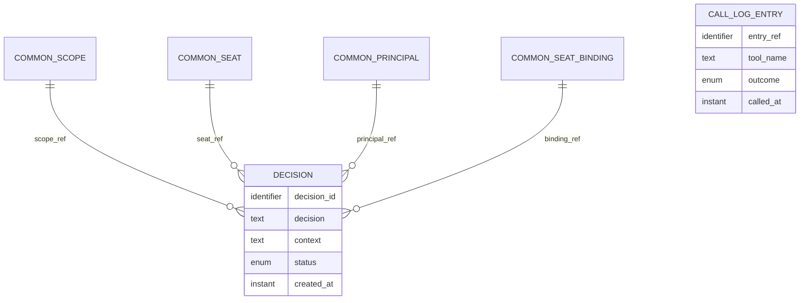

# U1 薄い一本の振る舞いの仕様

- 単位: U1 u1-seat-memory-skeleton（作業の単位の `inception/units-generation/unit-of-work.md`）
- この単位が作る話（`inception/user-stories/stories.md`）: US1.1・US1.2・US1.3・US3.1（場面 S3 の最小 = 決定だけ）・US5.1（自社の置き場所）・US5.3・US5.4・US9.1（呼出しの記録）・US9.3（自社の DB の資格情報）
- 記録の種類の正本は `entities.md`、決まりの正本は `rules.md`。この文書は流れと状態の正本で、図とまとめは両者から作った写し。
- 技術の置き方（共通基盤の配布物の取り込み方・Node の版・接続の時間）は、後の NFR・基盤の段階で決める。

## 流れ

### W1 起動と置き場所の決定

1. Kusabi（MCP サーバー、または起動の口）が起動する。
2. 設定 `AGENT_MEMORY_MODE` を読む。知らない値なら invalid_input で止まる（BR1.2）。
3. 形を決める。common なら共通基盤の形、standalone なら単独の形、無ければ Kusabi 専用の DB の設定（`AGENT_MEMORY_DATABASE_URL`）の有無で決める（BR1.2）。汎用の `DATABASE_URL` は見ない（BR1.1）。
4. 単独の形なら、今の版と同じ振る舞いで動く（BR6.1）。ここで終わり。
5. 共通基盤の形で専用の DB の設定が無ければ、placement_unset（設定の名前を示す）で止まり、どの DB にも表を作らない（BR1.3）。
6. 置き場所の DB に共通基盤の置き場が無ければ not_initialized を返し、表を作らない（BR1.6）。
7. 道具を受け付ける。

失敗の文には資格情報を入れない（BR5.2）。

### W2 決定を書く（共通基盤の形）

1. 席が道具 `log_decision` を呼ぶ（決定の文・理由・札・目印）。
2. 入力の形を確かめる。決定の文が空なら invalid_input。
3. 置き場所の DB につなぐ。届かなければ placement_unreachable を返し、ほかの置き場所に書かない（BR1.4）。前に届かなかった後でも、今届けばつなぎ直して続ける（BR1.5）。
4. 1 つの取引を始める。
5. 共通基盤の確かめで、DB の利用者から席を確かめる（BR2.1）。失敗なら、その理由を Kusabi の失敗の名前に写して返し、取引を戻す（BR2.2〜BR2.5）。
6. 決定を、確かめた所属範囲・主体・席・割り当て・世代の参照つきで、active として保存する（BR3.1・BR2.6）。
7. 取引を確定する。確かめと保存のどちらかが失敗したら、どちらも残さない（BR3.3）。
8. 呼出しの記録に、道具の名前・決定の ID・時刻・結果だけを書く（BR5.1）。
9. 決定の ID を返す。

### W3 決定を読む（共通基盤の形）

1. 席が道具 `get_decisions` を呼ぶ（目印・札・件数は任意）。
2. W2 の 3〜5 と同じく、つないで席を確かめる。
3. 確かめた席と同じ席・同じ所属範囲の、active の決定だけを返す（BR3.2）。ほかの席の決定は返さない。
4. 呼出しの記録に、道具の名前・返した決定の ID・時刻・結果だけを書く（BR5.1）。

### W4 起動の口の回復（Claude Code・Codex）

1. 席の道具が起動の hook を呼ぶ。
2. W1 で形を決める。単独の形なら今の版のまま。
3. 置き場所の DB につなぐ。届かなければ、memory_status=unreachable、決定は空で返し、席の起動は続ける（BR4.2）。
4. 共通基盤の確かめで席を確かめる。登録が無ければ memory_status=not_registered、決定は空で返し、起動は続ける。
5. その席の active の決定を読み（BR3.4）、書いた席・時刻つきのデータの枠で回復の内容に入れる（BR4.1・BR4.3）。
6. 席の道具の起動の hook の形で返す。資格情報は入れない（BR5.2）。

### W5 U1 にまだ無い道具（共通基盤の形）

1. 席が、作業の状態・学び・置き換え・会話の取り込みなど、U1 に無い記録の道具を呼ぶ。
2. not_yet_available（後の単位で入る）を返し、単独の形や今の表に書かない（BR3.5）。

### W6 薄い一本を見せる流れ（作り終わりの区切り）

1. 自社の機械の使い捨ての試験の DB を作る（作る前に、AUN の結合の試験の分とまとめて owner の決定を取る）。
2. 試験の DB に、共通基盤 0.2・0.3 の置き場と Kusabi の置き場を入れる。
3. 試験の所属範囲・主体・席・割り当てと、席ごとの DB の利用者を、試験の中で作る（合成のデータ）。
4. Codex の席の形の道具の呼出しで、決定を 1 件書く（W2）。
5. 会話を閉じて開き直すことに当たる、再起動をする。
6. Claude Code の席の形の起動の口を動かし、回復の内容に同じ決定が出ることを確かめる（W4）。
7. 負の確かめ: 登録の無い席は断られる。置き場所の DB を止めると書き込みは失敗し、手元の SQLite に書かれず、起動は止まらない。`DATABASE_URL` だけの時は表を作らない。呼出しの記録に決定の文が無い。
8. 試験の DB を消す。
9. 数えるのは上の流れ（試験の命令 1 本、何度でも同じ結果）。あわせて、本物の Codex の会話と Claude Code の会話でも 1 回ずつ同じ流れを確かめ、証拠に残す。本物の会話を開く時は、そのつど owner の決定を取る（質問の Q1 = C）。

## 状態

### 決定（Decision）

| 今の状態 | 出来事 | 条件 | 次の状態 | すること |
|----------|--------|------|----------|----------|
| （無し） | 保存 | 共通基盤の確かめが通る（BR2.1） | active | 参照つきで保存（BR3.1） |
| active | 置き換え | U2 で入る | superseded | U2 |

- U1 で作るのは active だけ。active から先へは U1 では動かない。superseded からは動かない（終わりの状態）。

### 割り当ての状態の受け止め（共通基盤の意味のまま、BR2.4）

| 共通基盤の割り当て | Kusabi の振る舞い |
|------------------|-------------------|
| active で期限内 | 読み書きできる |
| active で期限切れ | binding_closed |
| draining（引き継ぎ中） | binding_closed |
| closed | binding_closed |
| 無い | seat_not_registered か binding_closed（共通基盤の理由のとおり） |

## 記録の関係の図（`entities.md` から作った写し）

<!-- 文字での説明: 決定（DECISION）は、共通基盤の所属範囲・席・主体・割り当てをそれぞれ 1 つ参照し、1 つの席や所属範囲には多くの決定が属する。共通基盤の物は共通基盤が持ち、Kusabi は参照の値として持つ。呼出しの記録（CALL_LOG_ENTRY）は記憶の中身を持たず、ほかの記録とつながらない。 -->

## 決まりのまとめ（`rules.md` から作った写し）

| 群 | 決まり | 主な流れ |
|----|--------|----------|
| BR1 置き場所 | BR1.1〜BR1.6 | W1・W2 |
| BR2 席の確かめ | BR2.1〜BR2.7 | W2・W3・W4 |
| BR3 決定の記録 | BR3.1〜BR3.5 | W2・W3・W4・W5 |
| BR4 回復と起動の口 | BR4.1〜BR4.3 | W4 |
| BR5 呼出しの記録と資格情報 | BR5.1〜BR5.2 | W1〜W4 |
| BR6 単独の形 | BR6.1 | W1 |

## 後の段階へ渡すこと

- 共通基盤 0.2・0.3 の配布物の取り込み方（AUN は SQL の変えない写しと sha256 の試験）、固定する版（onza main 5beb404 か）、Node の版（共通基盤の adapter は Node 22.18 以上、Kusabi の CI は 18・20・22）、接続と確かめの時間の上限 → NFR・基盤の段階
- 使い捨ての試験の DB を作ること、本物の会話を開くこと → その時に owner の決定
