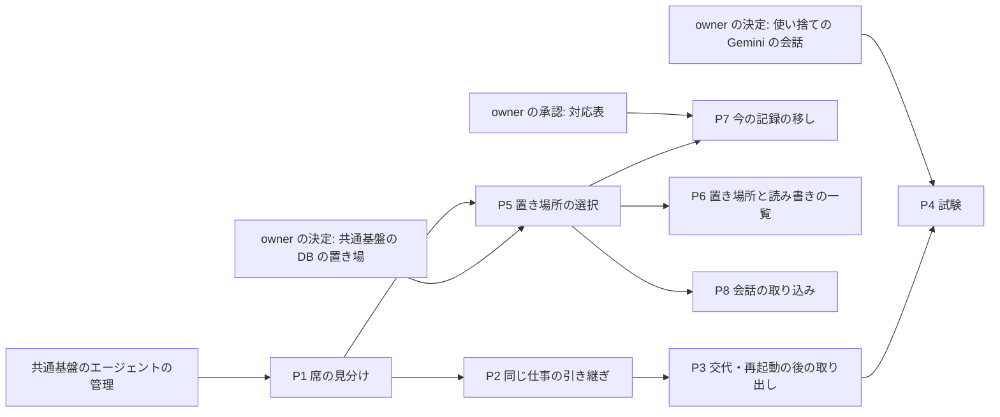

# 能力の一覧（優先順つき）

入力: 意図の文書（`ideation/intent-capture/intent-statement.md`）、実現性の見立て（`ideation/feasibility/feasibility-assessment.md`）、制約の一覧（`ideation/feasibility/constraint-register.md`）、範囲の文書（`scope-document.md`）、この段階の質問 Q1〜Q8 の答え。

優先度は MoSCoW（Must = 必ず入れる／Should = 入れたい／Could = 余裕があれば／Won't = 今回はやらない）で付けた。並びは「いちばん不確かな所から」（質問 Q6）の案で、具体の並びは後の計画の段階で決める。

## 最初の版に入れるもの

| 案の順 | ID | 能力 | 優先度 | 依存 | 不確かさ | 出典 |
|------|----|------|--------|------|---------|------|
| 1 | P2 | 種類の違う席の間で、同じ仕事の記憶を引き継ぐ。まず「同じ仕事」を何で見分けるかを決める | Must | P1 | 高（リスク R-01） | 意図の文書、質問 Q6 |
| 1 | P1 | 席が誰かを、共通基盤のエージェントの管理に合わせて見分ける（P2 と同じ所で扱う） | Must | 共通基盤のエージェントの管理 | 中 | 制約 C-03 |
| 2 | P3 | 担当交代と再起動の後に、決定・作業の状態・学びを取り出し、席が自分で続きを始められる | Must | P1・P2 | 中 | 意図の文書 |
| 3 | P4 | 担当交代と再起動の場面を決めた試験で、取り出せる割合を測る（Claude・Codex・Gemini の席。Gemini は使い捨ての会話、記録は合成のデータ） | Must | P2・P3、使い捨ての Gemini の会話を起こす owner の決定 | 中 | 意図の文書、質問 Q2・Q4・Q8 |
| 4 | P5 | 置き場所を顧客ごとに自社か顧客の DB のどちらか一方に選ぶ（自社 = 共通基盤の DB、顧客 = 顧客役の DB） | Must | 共通基盤の DB に置き場を入れる owner の決定 | 中 | 意図の文書、制約 C-02・C-07 |
| 5 | P7 | 今の記録を棚卸しし、owner が承認した対応表を通して共通基盤の DB へ移す（元は消さない） | Must | P1・P5、対応表の owner の承認 | 中（リスク R-03・R-04） | 実現性の質問 Q8 |
| 6 | P6 | 顧客ごとに、置き場所の DB と読み書きできる者の一覧を出す | Must | P1・P5 | 中（リスク R-05） | 意図の文書 |
| 7 | P8 | 会話の取り込み（Claude Code・Codex の会話の記録を Kusabi に入れる。今の版の機能を新しい置き場所でも使えるようにする） | Must（最初の版に入れる） | P5 | 低 | 質問 Q1 |

- P2 を先頭に置くのは、ここが成り立たないと引き継ぎの全体が成り立たないため。P2 を作るには席の見分け（P1）が要るので、P1 は P2 と同じ所で扱う。（質問 Q6、実現性の見立て）
- P4（試験）は完了の判定そのものなので、P2・P3 の後に置き、場面は要件の段階で決める。

## 今回はやらないもの（Won't）

| 項目 | 理由 | 出典 |
|------|------|------|
| 記憶の中身を AI が自動で要約・整理し直すこと | 最初の版でやらない | 意図の文書 |
| 自社の DB と顧客の DB の間の移行・同期 | 同じ記憶を 2 か所に置かない | 意図の文書 |
| 人が記憶を直接見たり直したりする画面 | 最初の版でやらない | 意図の文書 |
| 他社のエージェント製品からの利用 | 最初の版でやらない | 意図の文書 |
| 全席の会話を横断して探すこと | 入れない | 質問 Q1 |
| 会話の保存と取り直しの不具合（agent-memory#330）の修理 | 今ある修理の流れで別に扱う | 質問 Q3 |
| 製品の中のエージェントが記憶を使う形 | 後の版 | 意図の文書 |
| AUN との連動 | 今回は考えない | 制約 C-04 |

## 依存の図

<!-- Text fallback: 共通基盤のエージェントの管理 → P1 → P2 → P3 → P4。owner の決定（共通基盤の DB の置き場）と P1 → P5。P5 → P7（owner の承認: 対応表も必要）、P5 → P6、P5 → P8。owner の決定（使い捨ての Gemini の会話）→ P4。 -->

## 確かめていないこと

- P8 は最初の版に入れるが、完了の判定（範囲の文書）には含まれない。P8 が仕上がっていない時に最初の版を完了とするかは、後の計画の段階で確かめる。
- 実装の開始は、Kusabi の新しい実装の停止（T102）の解除を待つ（制約 C-10）。この一覧の順は、停止の間に進める設計の順としても使える。
