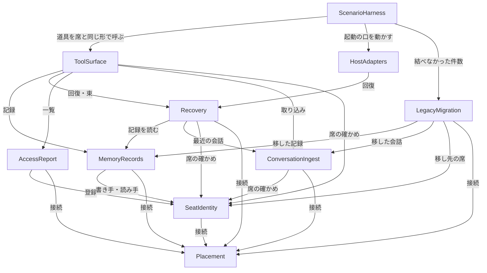

# 部品の一覧 — 席の記憶を自社か顧客の DB に保つ Kusabi

- 入力: 要件（`inception/requirements-analysis/requirements.md`）、利用者の話（`inception/user-stories/stories.md`）、今のコードの読み解き（`aidlc/spaces/default/codekb/agent-memory/architecture.md`・`component-inventory.md`）、共通基盤 0.2・0.3 の正本（onza main `5beb404` の `docs/common/0.2/architecture.md`・`contract.md`、`common/0.2/sql/001_schema.sql`）、この段階の Q1〜Q4
- この段階で決めるのは、作る部品の境目と、記録の持ち主まで。部品をどう置くか（1 つの process か分けるか）は Units Generation、型・検証の細かさは Functional Design、速さ・耐障害の工夫は NFR の段階で決める。
- 決定の理由は `decisions.md`（ADR-001〜ADR-007）。

## 部品の目録（正本）

```yaml
components:
  - name: Placement
    summary: 記憶をどの DB に置くかを、Kusabi 専用の設定だけから決め、その DB への接続を渡す
    behaviour: >
      席の起動の設定で渡された Kusabi 専用の DB の設定だけを読む。汎用の DATABASE_URL は読まない。
      設定が無い時は、設定の名前を挙げて起動を止める。DB に届かない時は、ほかの置き場所（手元の
      SQLite のファイル・別の DB）に切り替えず、届かないことを失敗として返す。「顧客 → 置き場所」の
      表は持たない（ADR-002）。接続の資格情報を記録・応答・呼出しの記録に出さない。
    responsibilities:
      - Kusabi 専用の DB の設定の読み取りと、無い時の停止
      - 置き場所の DB への接続と、届かない時の失敗の返し方
      - 資格情報を外に出さないこと
    depends_on: []
    dependents:
      - component: SeatIdentity
        interaction: 共通基盤の確かめの関数を呼ぶ接続を受け取る
      - component: MemoryRecords
        interaction: 記録を読み書きする接続を受け取る
      - component: Recovery
        interaction: 回復の設定と束を読み書きする接続を受け取る
      - component: AccessReport
        interaction: DB の権限を読む接続を受け取る
      - component: LegacyMigration
        interaction: 移し先の接続を受け取る
      - component: ConversationIngest
        interaction: 会話の出来事を書く接続を受け取る
    external_dependencies:
      - name: PostgreSQL（自社 = 共通基盤の DB、顧客 = 顧客ごとの DB）
        kind: database
        purpose: 記憶の置き場所
    entities: []

  - name: SeatIdentity
    summary: DB の利用者から、共通基盤の席・所属範囲・割り当てを確かめ、読み書きの主を決める
    behaviour: >
      本人の確かめは、接続した DB の利用者（session_user）から共通基盤の確かめの関数で行い、道具の
      引数や環境の値を本人の証拠にしない。共通基盤に登録の無い席、所属範囲の無い席、割り当てが
      閉じた席からの読み書きは、理由をつけて断る。確かめは、記録の保存と同じ transaction で行う
      （共通基盤 contract.md §5）。顧客の DB では、その DB の共通基盤で確かめる（ADR-001）。
      確かめた結果（所属範囲・主体・席・割り当て・世代）を、書く記録に付ける参照として渡す。
    responsibilities:
      - 書き手と読み手の席の確かめ
      - 登録の無い席・所属の無い席を断ること
      - 記録に付ける共通基盤の参照（所属範囲・主体・席・割り当て・世代）の用意
    depends_on:
      - component: Placement
        interaction: 置き場所の DB への接続を使い、その DB の共通基盤の確かめの関数を呼ぶ
        style: sync
    dependents:
      - component: ToolSurface
        interaction: 道具を呼んだ席の確かめ
      - component: MemoryRecords
        interaction: 書き手・読み手の確かめと参照の付与
      - component: Recovery
        interaction: 回復を受け取る席の確かめ
      - component: AccessReport
        interaction: 共通基盤の席の登録を一覧と並べるための読み取り
      - component: LegacyMigration
        interaction: 対応表の移し先の席が登録されているかの確かめ
      - component: ConversationIngest
        interaction: 会話を取り込む席の確かめ
    external_dependencies:
      - name: 共通基盤 0.2・0.3（onza の common の配布物と、DB の common の置き場）
        kind: other
        purpose: 席・主体・所属範囲・割り当て・在否の確かめ
    entities: []

  - name: MemoryRecords
    summary: 決定・作業の状態・学びを持ち、仕事の ID と読める範囲の決まりを守る
    behaviour: >
      記録には、書いた時点の共通基盤の参照（所属範囲・主体・席・割り当て）を付け、後から書き換えない。
      仕事の ID は GitHub の issue・PR の URL を `owner/repo#番号` の正規の形にそろえて付ける。形の
      違う URL は同じ仕事にまとめ、形でない文字列は断る。会話の起動の設定で既定の仕事の ID が
      渡されていれば自動で付け、道具の呼出しで別の ID が渡されればそれを優先する（ADR-003）。
      仕事の ID が付いた記録は、同じ所属範囲の席なら誰でも読める。付いていない記録は書いた席だけが
      読める。所属範囲をまたいで読ませない。同じ仕事に複数の席が作業の状態を書いても上書きせず
      席ごとに残す。記録は消さず、置き換え（supersede）と状態で引退させる。ほかの席の記録を置き換え・
      書き換えさせない。探すのは DB の中の文字の検索だけで、埋め込みを作らない（ADR-005）。
    responsibilities:
      - 決定・作業の状態・学びの保存と読み出し
      - 仕事の ID の正規化と、仕事の ID での読み出し
      - 読める範囲（席だけ・同じ所属範囲・所属範囲をまたがない）と書き換えの権限の決まり
      - 文字の検索
    depends_on:
      - component: SeatIdentity
        interaction: 書き手・読み手を確かめ、共通基盤の参照を受け取る
        style: sync
      - component: Placement
        interaction: 置き場所の DB への接続
        style: sync
    dependents:
      - component: ToolSurface
        interaction: 席が道具から記録を書く・読む・探す
      - component: Recovery
        interaction: 回復の内容と仕事の束に入れる記録を読む
      - component: LegacyMigration
        interaction: 移した記録を書く
    external_dependencies:
      - name: PostgreSQL（Kusabi の置き場）
        kind: database
        purpose: 記録の保存と文字の検索
    entities:
      - name: Decision
        identifier: decision_id
        attributes: [scope_ref, principal_ref, seat_ref, binding_ref, work_ref, project, decision, reason, status, supersedes, created_at]
      - name: TaskState
        identifier: task_state_id
        attributes: [scope_ref, principal_ref, seat_ref, binding_ref, work_ref, project, task_key, status, content, created_at, updated_at]
      - name: Knowledge
        identifier: knowledge_id
        attributes: [scope_ref, principal_ref, seat_ref, binding_ref, work_ref, project, memory_scope, title, content, tags, status, supersedes, created_at]

  - name: ConversationIngest
    summary: 席の道具の会話の記録を、伏せ字の処理をして、席の置き場所の DB に取り込む
    behaviour: >
      Claude Code・Codex の会話の記録を読み、鍵・token・資格情報の形の文字列を伏せ、隠れた推論と
      開発者向けの指示の本文を外して、席の所属の置き場所に書く。同じ出来事は 2 回入れない（出所の
      digest で見分ける）。ほかの置き場所に写しを置かない。会話の保存と取り直しの不具合
      （agent-memory#330）はここでは直さない。
    responsibilities:
      - 会話の記録の読み取りと伏せ字の処理
      - 会話の出来事の保存と、重ならない取り込み
      - 回復のための最近の会話の読み出し
    depends_on:
      - component: SeatIdentity
        interaction: 取り込む席の確かめと共通基盤の参照の付与
        style: sync
      - component: Placement
        interaction: 置き場所の DB への接続
        style: sync
    dependents:
      - component: ToolSurface
        interaction: 席が道具から取り込みを流す・会話の一部を読む
      - component: Recovery
        interaction: 回復の内容に最近の会話を入れる
      - component: LegacyMigration
        interaction: 今の会話の出来事を移す
    external_dependencies:
      - name: 席の道具の手元の会話の記録（Claude Code・Codex の JSONL）
        kind: other
        purpose: 取り込みの元（読むだけ）
    entities:
      - name: ConversationEvent
        identifier: event_id
        attributes: [scope_ref, seat_ref, work_ref, source, source_ref_hash, role, content_text, redaction_version, event_at, ingested_at]

  - name: Recovery
    summary: 起動の時・圧縮の後の回復の内容と、仕事の ID 1 回でまとめて返す束を作る
    behaviour: >
      席の進行中の作業・有効な決定・学び・最近の会話を、回復の設定の上限の中で集め、記録を書いた席・
      時刻・仕事の ID つきの「データ」として出す。記録の中の命令の形の文を指示として出さない。入り
      きらない時は省いた件数と続きの取り出し方を書く。仕事の ID を 1 つ受けると、その仕事の決定・
      作業の状態・学びを 1 回の応答で返し、無い種類は「無い」と示す。回復の設定は席が自分の物だけを
      書き換えられる。起動の口の期限の中で終わらない時は、回復を省いたことを出して打ち切る。何を
      いくつ返したかを回復の質の記録に残す。AUN の表は読まない（ADR-005）。
    responsibilities:
      - 起動の時・圧縮の後の回復の内容
      - 仕事の ID でまとめて返す束
      - 回復の設定（席ごと）と回復の質の記録
      - 再起動の束の用意と受け渡し
    depends_on:
      - component: MemoryRecords
        interaction: 回復と束に入れる決定・作業の状態・学びを読む
        style: sync
      - component: ConversationIngest
        interaction: 最近の会話を読む
        style: sync
      - component: SeatIdentity
        interaction: 回復を受け取る席の確かめ
        style: sync
      - component: Placement
        interaction: 回復の設定と束を読み書きする接続
        style: sync
    dependents:
      - component: ToolSurface
        interaction: 席が道具から回復・束を受け取る
      - component: HostAdapters
        interaction: 起動の口が最初の文脈に入れる回復を受け取る
    external_dependencies: []
    entities:
      - name: RecoveryConfig
        identifier: seat_ref
        attributes: [scope_ref, seat_ref, decision_limit, task_limit, knowledge_limit, conversation_limit, updated_at]
      - name: RestartPack
        identifier: pack_ref
        attributes: [scope_ref, seat_ref, work_ref, content, created_at, consumed_at]
        references:
          - entity: TaskState
            owned_by: MemoryRecords
            relationship: 1 つの束は、作った時点のその席の作業の状態から作られる
      - name: RecoveryQualityRecord
        identifier: quality_record_id
        attributes: [scope_ref, seat_ref, session_ref, returned_counts, recovered_tokens, continued, created_at]

  - name: AccessReport
    summary: 置き場所の DB と、実際の DB の権限から作る読み書きできる者の一覧と、共通基盤の登録との食い違いを出す
    behaviour: >
      一覧は、置き場所の DB の実際の権限（DB の利用者と、その利用者が読み書きできる Kusabi の表）から
      作る。共通基盤の席の登録と並べ、登録に無いのに読み書きできる者、登録にあるのに読み書きできない
      者を食い違いとして示す。応答に記憶の中身を入れない。権限を読めない時は「観測できず」と返し、
      空の一覧と区別する。画面は作らず、道具の応答で返す。顧客の DB では、その DB の権限と、その DB
      の共通基盤の登録で作る（ADR-001）。
    responsibilities:
      - 置き場所と読み書きできる者の一覧
      - 共通基盤の登録との食い違い
      - 観測できない時の扱い
    depends_on:
      - component: SeatIdentity
        interaction: 共通基盤の席の登録を読み、一覧と並べる
        style: sync
      - component: Placement
        interaction: DB の権限を読む接続
        style: sync
    dependents:
      - component: ToolSurface
        interaction: owner が道具から一覧を出す
    external_dependencies:
      - name: PostgreSQL の権限の情報（利用者と表の権限）
        kind: database
        purpose: 実際に読み書きできる者の観測
    entities: []

  - name: LegacyMigration
    summary: 今の記録を棚卸しし、owner が承認した対応表に従って新しい置き場所へ移し、戻す手順を確かめる
    behaviour: >
      席ごとの SQLite のファイルと今の PostgreSQL を読むだけで、元の記録を消さず変えない。棚卸しは
      置き場所ごと・持ち主（agent_id・project）ごと・記録の種類ごとに数え、読めないファイルは理由を
      出してほかを続ける。対応表が承認されていなければ何も移さない。対応表にある持ち主の記録だけを
      その席の記録として移し、無い記録は推測で結ばず「つながっていない記録」として数える。移しは
      2 回流しても 1 回と同じ結果になり、途中で止まっても流し直せば欠けも重なりも出ない。新しい
      置き場所へ切り替える前に、元の置き場所へ戻す手順を試す。共通基盤の DB への移しは owner の
      決定の後に行う（保護面）。
    responsibilities:
      - 今の記録の棚卸し
      - 対応表に従う移しと、つながっていない記録の件数
      - 何度流しても同じになる移し
      - 戻す手順の試し
    depends_on:
      - component: MemoryRecords
        interaction: 移した決定・作業の状態・学びを書く
        style: sync
      - component: ConversationIngest
        interaction: 移した会話の出来事を書く
        style: sync
      - component: SeatIdentity
        interaction: 対応表の移し先の席が登録されているかを確かめる
        style: sync
      - component: Placement
        interaction: 移し先の DB への接続
        style: sync
    dependents:
      - component: ScenarioHarness
        interaction: 試験の結果に、結べなかった古い記録の件数を出す
    external_dependencies:
      - name: 今の記録の置き場所（席ごとの SQLite のファイル、今の PostgreSQL）
        kind: database
        purpose: 移しの元（読むだけ）
    entities:
      - name: SeatMapping
        identifier: mapping_id
        attributes: [legacy_agent_id, legacy_project, seat_ref, scope_ref, revision, approved_by, approved_at]
      - name: MigrationRun
        identifier: run_id
        attributes: [mapping_revision, source_ref, state, counts_by_kind, unlinked_count, started_at, finished_at]
      - name: UnlinkedRecord
        identifier: legacy_record_ref
        attributes: [source_ref, legacy_agent_id, legacy_project, kind, found_in_run]

  - name: ToolSurface
    summary: 席に MCP の道具を出し、呼出しの記録に記憶の中身を書かない
    behaviour: >
      席に出す道具の入口。どの道具も、呼んだ席を SeatIdentity で確かめてから、受け持ちの部品へ渡す。
      道具の入力は形を確かめ、形の違う入力は理由をつけて断る。呼出しの記録には、道具の名前と ID
      （記録の ID・仕事の ID・時刻）だけを書き、決定の文・作業の名前・学びの題などの記憶の中身や
      資格情報を書かない。一覧の道具は記憶の中身を返さない。
    responsibilities:
      - 席に出す MCP の道具の入口
      - 道具の入力の形の確かめ
      - 中身を書かない呼出しの記録
    depends_on:
      - component: MemoryRecords
        interaction: 記録を書く・読む・探す道具
        style: sync
      - component: Recovery
        interaction: 回復・束の道具
        style: sync
      - component: AccessReport
        interaction: 一覧の道具
        style: sync
      - component: ConversationIngest
        interaction: 取り込みと会話の読み出しの道具
        style: sync
      - component: SeatIdentity
        interaction: 道具を呼んだ席の確かめ
        style: sync
    dependents:
      - component: ScenarioHarness
        interaction: 試験の手順が、席と同じ形で道具を呼ぶ
    external_dependencies:
      - name: MCP の口（stdio）
        kind: other
        purpose: 席の道具からの呼出し
      - name: 手元の呼出しの記録のファイル
        kind: other
        purpose: 道具の名前と ID だけの呼出しの記録
    entities:
      - name: CallLogEntry
        identifier: entry_ref
        attributes: [tool_name, record_refs, work_ref, called_at, outcome]

  - name: HostAdapters
    summary: Claude Code・Codex・Gemini の起動の口で、回復の内容を席の最初の文脈に入れる
    behaviour: >
      席の道具ごとの起動の口から Recovery を呼び、回復の内容を最初の文脈に差し込む。起動の口の期限
      （native の起動の口では 7 秒）の中で終わらない時、または置き場所の DB に届かない時は、席の起動を
      止めず、回復を省いたこと・記憶に届かないことを最初の文脈に出す。起動の設定で渡された既定の
      仕事の ID を、その会話の記録に付けるために渡す（ADR-003）。
    responsibilities:
      - 席の道具ごとの起動の口
      - 期限と届かない時の振る舞い
      - 起動の設定の既定の仕事の ID の受け渡し
    depends_on:
      - component: Recovery
        interaction: 最初の文脈に入れる回復の内容を受け取る
        style: sync
    dependents:
      - component: ScenarioHarness
        interaction: 試験の手順が、本物と同じ形で起動の口を動かす
    external_dependencies:
      - name: 席の道具の起動の hook（Claude Code・Codex・Gemini）
        kind: other
        purpose: 起動の時と圧縮の後の呼出し
    entities: []

  - name: ScenarioHarness
    summary: 場面 S1〜S5 の試験を回し、取り出せる割合と結べなかった古い記録の件数を出す
    behaviour: >
      試験の場面ごとに合成のデータの記録を作り、起動の口と MCP の道具の呼出しを本物の席と同じ形で
      再現して回す。数えるのは、起動の時の回復の内容に入っていた記録と、指示の仕事の ID だけで道具を
      1 回呼んで返った記録だけ。母数は試験の場面で作った記録だけで、今の記録を入れない。1 件でも
      取り出せなければ失敗。回せなかった場面は「観測できず」とし、成功に数えない。結べなかった古い
      記録の件数は割合とは別に出す。外のサービスを使わず、同じ準備で 2 回流せば同じ結果になる。本物の
      席での確かめは席の種類ごとに 1 回ずつ別に行い、証拠として残す（数には入れない）（ADR-006）。
    responsibilities:
      - 場面 S1〜S5 の試験と数え方
      - 結果の出し方（場面ごとの数・全体の割合・観測できず・結べなかった件数）
      - 本物の席での確かめの証拠の置き場
    depends_on:
      - component: ToolSurface
        interaction: 席と同じ形で道具を呼ぶ
        style: sync
      - component: HostAdapters
        interaction: 本物と同じ形で起動の口を動かす
        style: sync
      - component: LegacyMigration
        interaction: 結べなかった古い記録の件数を読む
        style: sync
    dependents: []
    external_dependencies:
      - name: 試験の DB（自社役・顧客役。自社の機械の中）
        kind: database
        purpose: 試験の場面の記録の置き場所
    entities:
      - name: ScenarioResult
        identifier: run_id
        attributes: [scenario, created_count, retrieved_count, observable, unlinked_legacy_count, started_at, finished_at]
```

## 部品の図



<!-- 文字での説明: いちばん下は Placement（置き場所への接続）で、その上に SeatIdentity（席の確かめ）がある。MemoryRecords（記録）と ConversationIngest（会話の取り込み）は SeatIdentity と Placement を使う。Recovery（回復）は MemoryRecords・ConversationIngest・SeatIdentity・Placement を使う。AccessReport（一覧）は SeatIdentity と Placement を使う。LegacyMigration（移し）は MemoryRecords・ConversationIngest・SeatIdentity・Placement を使う。ToolSurface（道具）は MemoryRecords・Recovery・AccessReport・ConversationIngest・SeatIdentity を使い、HostAdapters（起動の口）は Recovery を使う。ScenarioHarness（試験）は ToolSurface・HostAdapters・LegacyMigration を使う。向きは上から下だけで、輪は無い。 -->

## 部品のまとめ

| Component | Purpose | Depends On | Dependents | Entities Owned |
|-----------|---------|------------|------------|----------------|
| Placement | 置き場所の DB を専用の設定だけで決め、届かない時に逃げない | — | SeatIdentity, MemoryRecords, Recovery, AccessReport, LegacyMigration, ConversationIngest | — |
| SeatIdentity | DB の利用者から共通基盤の席・所属範囲・割り当てを確かめる | Placement | ToolSurface, MemoryRecords, Recovery, AccessReport, LegacyMigration, ConversationIngest | — |
| MemoryRecords | 決定・作業の状態・学びと、仕事の ID・読める範囲の決まり | SeatIdentity, Placement | ToolSurface, Recovery, LegacyMigration | Decision, TaskState, Knowledge |
| ConversationIngest | 会話の伏せ字の処理と取り込み | SeatIdentity, Placement | ToolSurface, Recovery, LegacyMigration | ConversationEvent |
| Recovery | 回復の内容と仕事の束 | MemoryRecords, ConversationIngest, SeatIdentity, Placement | ToolSurface, HostAdapters | RecoveryConfig, RestartPack, RecoveryQualityRecord |
| AccessReport | 置き場所と読み書きできる者の一覧・食い違い | SeatIdentity, Placement | ToolSurface | — |
| LegacyMigration | 棚卸し・対応表に従う移し・戻す手順 | MemoryRecords, ConversationIngest, SeatIdentity, Placement | ScenarioHarness | SeatMapping, MigrationRun, UnlinkedRecord |
| ToolSurface | MCP の道具の入口と中身を書かない呼出しの記録 | MemoryRecords, Recovery, AccessReport, ConversationIngest, SeatIdentity | ScenarioHarness | CallLogEntry |
| HostAdapters | 席の道具ごとの起動の口 | Recovery | ScenarioHarness | — |
| ScenarioHarness | 場面 S1〜S5 の試験と数え方 | ToolSurface, HostAdapters, LegacyMigration | — | ScenarioResult |

## 記録の持ち主

| Entity | Owning Component | Identifier | Attributes | References |
|--------|------------------|------------|------------|------------|
| Decision | MemoryRecords | decision_id | scope_ref, principal_ref, seat_ref, binding_ref, work_ref, project, decision, reason, status, supersedes, created_at | 共通基盤の所属範囲・主体・席・割り当て（参照の値として持つ） |
| TaskState | MemoryRecords | task_state_id | scope_ref, principal_ref, seat_ref, binding_ref, work_ref, project, task_key, status, content, created_at, updated_at | 同上 |
| Knowledge | MemoryRecords | knowledge_id | scope_ref, principal_ref, seat_ref, binding_ref, work_ref, project, memory_scope, title, content, tags, status, supersedes, created_at | 同上 |
| ConversationEvent | ConversationIngest | event_id | scope_ref, seat_ref, work_ref, source, source_ref_hash, role, content_text, redaction_version, event_at, ingested_at | 同上 |
| RecoveryConfig | Recovery | seat_ref | scope_ref, seat_ref, decision_limit, task_limit, knowledge_limit, conversation_limit, updated_at | — |
| RestartPack | Recovery | pack_ref | scope_ref, seat_ref, work_ref, content, created_at, consumed_at | TaskState（MemoryRecords） |
| RecoveryQualityRecord | Recovery | quality_record_id | scope_ref, seat_ref, session_ref, returned_counts, recovered_tokens, continued, created_at | — |
| SeatMapping | LegacyMigration | mapping_id | legacy_agent_id, legacy_project, seat_ref, scope_ref, revision, approved_by, approved_at | — |
| MigrationRun | LegacyMigration | run_id | mapping_revision, source_ref, state, counts_by_kind, unlinked_count, started_at, finished_at | — |
| UnlinkedRecord | LegacyMigration | legacy_record_ref | source_ref, legacy_agent_id, legacy_project, kind, found_in_run | — |
| CallLogEntry | ToolSurface | entry_ref | tool_name, record_refs, work_ref, called_at, outcome | — |
| ScenarioResult | ScenarioHarness | run_id | scenario, created_count, retrieved_count, observable, unlinked_legacy_count, started_at, finished_at | — |

- 共通基盤の所属範囲・主体・席・割り当ては共通基盤（onza の common）が持つ。Kusabi は参照の値（`scope_ref` など）として持つだけで、持ち主にはならない。
- `work_ref`（仕事の ID）は MemoryRecords が正規の形を決める値で、ConversationEvent・RestartPack・CallLogEntry も同じ形で持つ。

## 外の依存

| Component | Dependency | Kind | Purpose |
|-----------|------------|------|---------|
| Placement | PostgreSQL（自社 = 共通基盤の DB、顧客 = 顧客ごとの DB） | database | 記憶の置き場所 |
| SeatIdentity | 共通基盤 0.2・0.3（onza の common の配布物と、DB の common の置き場） | other | 席・主体・所属範囲・割り当て・在否の確かめ |
| MemoryRecords | PostgreSQL（Kusabi の置き場） | database | 記録の保存と文字の検索 |
| ConversationIngest | 席の道具の手元の会話の記録 | other | 取り込みの元（読むだけ） |
| AccessReport | PostgreSQL の権限の情報 | database | 実際に読み書きできる者の観測 |
| LegacyMigration | 今の記録の置き場所（SQLite のファイル、今の PostgreSQL） | database | 移しの元（読むだけ） |
| ToolSurface | MCP の口（stdio）、手元の呼出しの記録のファイル | other | 席からの呼出し、中身を書かない記録 |
| HostAdapters | 席の道具の起動の hook | other | 起動の時と圧縮の後の呼出し |
| ScenarioHarness | 試験の DB（自社役・顧客役） | database | 試験の場面の記録の置き場所 |

- 使わなくなる物: Voyage AI（埋め込み）、AUN の `agent_messages` 表の読み出し（ADR-005）。

## 理由

| 部品 | 別の部品にする理由 |
|------|-------------------|
| Placement | 置き場所を決める決まり（専用の設定だけ・逃げない・資格情報を出さない）は全部品に共通で、1 か所に置かないと決まりが部品ごとにばらける（設計・実装の標準 S3） |
| SeatIdentity | 共通基盤との境目。共通基盤の版が上がっても、変わるのはこの部品だけにしたい。6 つの部品が使う |
| MemoryRecords | 記憶の核。仕事の ID・読める範囲・書き換えの権限の決まりを 1 か所で持つ |
| ConversationIngest | 元が手元の会話のファイルで、伏せ字の処理という別の決まりを持つ。変わる速さが席の道具の版に引っ張られる |
| Recovery | 読み出しの組み立て（上限・データとしての出し方・省略の書き方・期限）は記録の保存と別の関心で、席の道具ごとの起動の口と ToolSurface の 2 つから使う |
| AccessReport | 記憶の中身を読まずに権限だけを読む、別の読み手。顧客に見せる証明で、中身に触れないことを部品の境目で守る |
| LegacyMigration | 一度だけ流す作業で、元の置き場所を読む唯一の部品。移しが済んだら使わなくなる |
| ToolSurface | 席との境目。呼出しの記録の決まり（中身を書かない）をここに置く |
| HostAdapters | 席の道具ごとに違う起動の hook。席の道具の版に合わせて変わる |
| ScenarioHarness | 完了の判定の数を出す試験のコード。製品の振る舞いと別に変わる |

### 境目の選択肢（席の確かめを独立の部品にするか）

- 案 A — SeatIdentity を独立の部品にする: 共通基盤の版が上がった時に直す所が 1 つで済む。6 つの部品が同じ確かめを使える。部品が 1 つ増える。戻しやすさ: 高い（後でまとめるのは易しい）
- 案 B — 席の確かめを MemoryRecords の中に入れる: 部品が減る。一方、Recovery・AccessReport・LegacyMigration・ConversationIngest が MemoryRecords を通さないと席を確かめられず、記録の部品が共通基盤の版に引っ張られる。戻しやすさ: 低い（後で分けると、呼んでいる所を全部直す）
- 勧め: 案 A。共通基盤の版の変化の速さと、記録の決まりの変化の速さが違うため（ADR-004）

#### Alternatives Rejected

- 案 B（席の確かめを MemoryRecords に入れる）: 上の理由で採らない。
- 今の版のまま、席の見分けを `agent_id` の環境の値で続ける: 共通基盤の決まり（渡された値を本人の証拠にしない）と、要件 FR1.1（自前の席の一覧を持たない）に合わない。
- 顧客ごとの置き場所の表を Kusabi に持つ（Placement に表を持たせる）: Q2 = A で採らない（ADR-002）。
