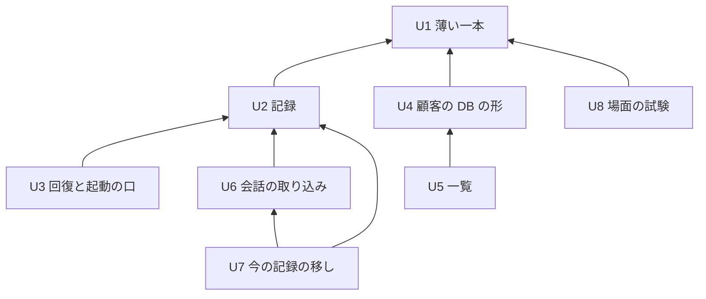

# 単位の依存

- この文書は依存の形（何が何に依存できるか）だけを書く。どれから作るか・重要な経路は計画の段階（Delivery Planning）で決める。

## 依存の辺（機械が読む正本）

```yaml
units:
  - name: u1-seat-memory-skeleton
    kind: service
    depends_on: []
  - name: u2-memory-records
    kind: service
    depends_on: [u1-seat-memory-skeleton]
  - name: u3-recovery-and-hosts
    kind: service
    depends_on: [u2-memory-records]
  - name: u4-customer-placement
    kind: service
    depends_on: [u1-seat-memory-skeleton]
  - name: u5-access-report
    kind: service
    depends_on: [u4-customer-placement]
  - name: u6-conversation-ingest
    kind: service
    depends_on: [u2-memory-records]
  - name: u7-legacy-migration
    kind: service
    depends_on: [u2-memory-records, u6-conversation-ingest]
  - name: u8-scenario-harness
    kind: library
    depends_on: [u1-seat-memory-skeleton]
```

## 依存の図



<!-- 文字での説明: 矢印は「左が右に依存する」。U1 はどれにも依存しない。U2・U4・U8 は U1 に、U3 と U6 は U2 に、U5 は U4 に、U7 は U2 と U6 に依存する。輪は無い。 -->

## 依存の理由

| 単位 | 依存先 | 理由 |
|------|--------|------|
| U2 | U1 | 置き場所・席の確かめ・決定の表と道具の入口（U1）の上に、作業の状態・学び・仕事の ID を足す |
| U3 | U2 | 回復の内容と仕事の束は、作業の状態・学び・仕事の ID での読み出し（U2）を読む |
| U4 | U1 | 顧客の DB の形は、置き場所と席の確かめ（U1）を、共通基盤と Kusabi の置き場を持つ顧客の DB で動かす |
| U5 | U4 | 一覧は、顧客の DB を含む置き場所ごとに出すので、顧客の DB の形（U4）が要る |
| U6 | U2 | 会話の出来事は、仕事の ID の正規の形と読める範囲の決まり（U2）を使う |
| U7 | U2・U6 | 移しは、決定・作業の状態・学び（U2）と会話の出来事（U6）を新しい置き場所に書く |
| U8 | U1 | 試験は、道具の入口と起動の口（U1）があれば書ける。場面の試験を実装より先に書くため、U2・U3 には依存させない |

## 単位の間のつなぎ目

| つなぎ目 | 間の単位 | 形 |
|----------|----------|----|
| 置き場所の接続 | U1 → すべて | Placement の口から接続を受け取る。ほかの単位は設定を自分で読まない |
| 席の確かめ | U1 → U2〜U7 | SeatIdentity の口で、保存と同じ transaction の中で共通基盤の確かめの関数を呼ぶ |
| 記録の表 | U1・U2 → U3・U6・U7 | 記録は MemoryRecords の口を通して読み書きする。ほかの単位は Kusabi の表を直接書かない |
| 会話の出来事 | U6 → U3・U7 | 最近の会話の読み出しと、移した出来事の書き込みは ConversationIngest の口を通す |
| 道具の入口 | U1 → U2〜U6・U8 | MCP の道具の形。後の単位は道具を足し、U8 は席と同じ形で呼ぶ |
| 起動の口 | U1・U3 → U8 | 席の道具の起動の hook の形。U8 は本物と同じ形で動かす |
| 移しの記録 | U7 → U8 | 結べなかった古い記録の件数を、LegacyMigration の読み出しの口から読む。U7 が無い時は「移しをまだ流していない」と出す（依存の辺にはしない） |
| 共通基盤 | 外 → U1・U4・U5 | onza の common 0.2・0.3 の配布物（版を固定）と、DB の common の置き場 |

## 並べて作れる組

- U1 の後: U2・U4・U8 は互いに依存しない
- U2 の後: U3 と U6 は互いに依存しない
- U4 の後の U5 は、U2・U3・U6・U7 と互いに依存しない
- U7 は U2 と U6 の後

（どの組から作るかは計画の段階で決める）

## 薄い一本（U1）

- U1 は依存の最初の単位で、どの単位にも依存しない。
- U1 だけで、専用の設定 → 置き場所の DB への接続 → 共通基盤での席の確かめ → 決定を 1 件書く（Codex の席の道具から）→ 再起動 → Claude Code の席の起動の口で同じ決定を回復の内容として受け取る、が端から端まで動く。
- 確かめは自社の機械の使い捨ての試験の DB で行い、試験の中で共通基盤 0.2・0.3 と Kusabi の置き場を作って、終われば消す。後の単位（U2〜U8）が無くても動く。
- 実際に動くことの確かめと見せ方は、計画の段階で決める。
