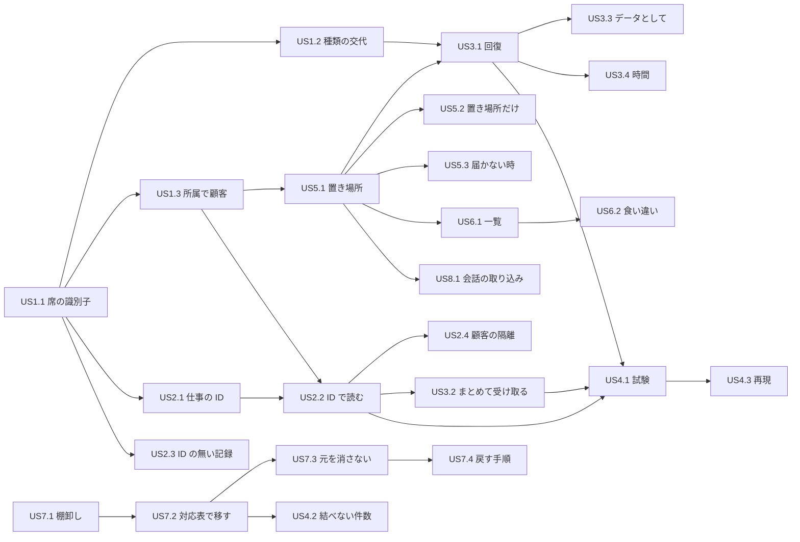

# 利用者の話

- 入力: 要件（`inception/requirements-analysis/requirements.md`）、使い手（`personas.md`）、話の立て方（`user-stories-questions.md` の Q1〜Q3）
- 分け方: 要件の能力ごと（US1〜US8 = FR1〜FR8）。非機能の要件のうち話にする物は US9 にまとめた
- 試験の場面: S1 同じ席の再起動、S2 文脈の圧縮の後、S3 同じ役割の席の種類の交代、S4 別の役割の席への担当交代、S5 Gemini（使い捨ての会話）を含む交代。S1〜S3 は US3.1、S4・S5 は US2.2 の受入の条件に置いた
- 確かめ方: 人が見る画面は無いので、受入の条件は道具の応答・起動の時の回復・DB の中身で確かめる

## 一覧

| ID | 使い手 | 話（短く） | 優先 | 要件 |
|----|--------|-----------|------|------|
| US1.1 | P-A | 自分の記録に共通基盤の席の識別子が付く | Must | FR1.1・FR1.2 |
| US1.2 | P-A | 種類が替わっても同じ席の記憶を読む | Must | FR1.3 |
| US1.3 | P-C | 席の所属で顧客が決まる | Must | FR1.4 |
| US2.1 | P-A | 記録に仕事の ID を付ける | Must | FR2.1・FR2.2 |
| US2.2 | P-B | 仕事の ID で前の担当の記録を読む | Must | FR2.3・FR2.6・FR2.7・NFR9 |
| US2.3 | P-C | 仕事の ID の無い記録は書いた席だけが読む | Must | FR2.4 |
| US2.4 | P-D | 別の顧客の席に自社の記録を読ませない | Must | FR2.5・NFR2 |
| US3.1 | P-A | 再起動・圧縮・種類の交代の後に自分の続きが渡される | Must | FR3.1 |
| US3.2 | P-B | 仕事の ID 1 回で 3 種類の記録をまとめて受け取る | Must | FR3.2 |
| US3.3 | P-A | 取り出した記録がデータとして、省略を隠さずに渡される | Must | FR3.3・FR3.4 |
| US3.4 | P-A | 起動の時の回復が時間の中で終わり、起動を止めない | Must | NFR4 |
| US4.1 | P-C | 場面 S1〜S5 の試験で取り出せる割合を見る | Must | FR4.1・FR4.2・FR4.3・FR4.5・NFR5 |
| US4.2 | P-C | 結べなかった古い記録の件数を別に見る | Must | FR4.4 |
| US4.3 | P-C | 試験を自社の機械で再現する | Must | FR4.6・NFR10 |
| US5.1 | P-C | 顧客ごとに置き場所を一方に決める | Must | FR5.1・FR5.4 |
| US5.2 | P-D | 記録が選んだ置き場所にだけある | Must | FR5.2 |
| US5.3 | P-A | 置き場所に届かない時に失敗を知る | Must | FR5.3・NFR5 |
| US5.4 | P-C | Kusabi が汎用の DATABASE_URL を拾わない | Must | FR5.5 |
| US6.1 | P-D | 置き場所と読み書きできる者の一覧を見せてもらう | Must | FR6.1・FR6.2・FR6.4 |
| US6.2 | P-C | 登録と実際の権限の食い違いを見る | Must | FR6.3・FR6.5 |
| US7.1 | P-C | 今の記録を棚卸しする | Must | FR7.1 |
| US7.2 | P-C | 承認した対応表で移し、結べない記録は残す | Must | FR7.2・FR7.3 |
| US7.3 | P-C | 移しで元を消さず、何度流しても同じになる | Must | FR7.4・FR7.5・NFR7 |
| US7.4 | P-C | 切り替えの前に元へ戻す手順を試す | Must | FR7.6・NFR6 |
| US8.1 | P-A | 会話が所属の顧客の置き場所に取り込まれる | Must | FR8.1・FR8.2・FR8.3 |
| US9.1 | P-C | 記憶の中身が外に出ない | Must | NFR1 |
| US9.2 | P-C | 席は自分の記録と設定だけを書き換える | Must | NFR3 |
| US9.3 | P-C | DB の資格情報が記録・応答に出ない | Must | NFR8 |

- すべて Must にした。範囲の段で owner が P1〜P8 を最初の版に入れると決めたため（D-23）。会話の取り込み（US8.1）は Q3 = A で Must。完了の判定に含めるかは計画の段で確かめる。最初の版の境目は計画の段で決める。

## US1 席の見分け

### US1.1 自分の記録に共通基盤の席の識別子が付く

P-A 記憶を書く席として、自分が書いた記録に共通基盤の席の識別子が付いてほしい。どの席の記録かが後から確かに分かるために。

- **AC1.1.1** Given 共通基盤に登録された席 A が、When 決定を 1 件書く、Then その記録に席 A の共通基盤の識別子が付いて保たれる。
- **AC1.1.2** Given 共通基盤に登録の無い席が、When 決定を書こうとする、Then 記録は増えず、「この席は共通基盤に登録されていない」という理由つきの失敗が返る。
- **AC1.1.3** Given 共通基盤に登録の無い席が、When 記録を読もうとする、Then 何も返らず、同じ理由つきの失敗が返る。
- 依存: なし（最初の薄い一本の土台）
- INVEST: 席の見分けだけで試せる。共通基盤の登録が前提（要件の前提 AS2・AS3）

### US1.2 種類が替わっても同じ席の記憶を読む

P-A 記憶を書く席として、席の種類が替わっても（Codex から Claude Code へなど）、同じ席として前の種類で書いた記憶を読みたい。種類を替えるたびに経緯を説明し直さないために。

- **AC1.2.1** Given 共通基盤で同じ席 A として Codex の席が決定を書いた、When Claude Code の席が席 A として記録を読む、Then その決定が返る。
- **AC1.2.2** Given 共通基盤で別の席 B として登録された Claude Code の席が、When 席 A の仕事の ID の無い記録を読もうとする、Then その記録は返らない。
- 依存: US1.1
- INVEST: 種類の交代だけを試す。場面 S3 の試験は US3.1 に置く

### US1.3 席の所属で顧客が決まる

P-C owner として、席の記録がどの顧客のものかを、共通基盤の席の所属で決めたい。1 つの席の中で顧客の記録が混ざらないために。

- **AC1.3.1** Given 所属が顧客 X の席が、When 記録を書く、Then その記録は顧客 X のものとして保たれる。
- **AC1.3.2** Given 共通基盤で席の所属を顧客 X から顧客 Y に替えた、When その席が新しく記録を書く、Then 新しい記録は顧客 Y のものになり、前の記録は顧客 X のままになる。
- **AC1.3.3** Given 共通基盤で所属が決まっていない席が、When 記録を書こうとする、Then 記録は増えず、所属が無いという理由つきの失敗が返る。
- 依存: US1.1
- INVEST: 所属の読み取りだけで試せる。所属で顧客を表せるかは設計の段で確かめる（要件の前提 AS2）

## US2 別の役割の席への引き継ぎ

### US2.1 記録に仕事の ID を付ける

P-A 記憶を書く席として、決定・作業の状態・学びを書く時に、その仕事の GitHub の issue か PR の URL を付けたい。別の役割の席がその URL だけで続きを読めるために。

- **AC2.1.1** Given 席 A が仕事 `https://github.com/watchout/agent-memory/issues/330` の作業の状態を書く、When その URL を付ける、Then 記録には正規の形 `watchout/agent-memory#330` で仕事の ID が保たれる。
- **AC2.1.2** Given 同じ issue を指す 4 通りの書き方（http・末尾の `/`・`#issuecomment-…` 付き・`/pull/330`）で記録を書いた、When 仕事の ID `watchout/agent-memory#330` で読む、Then 4 件とも返る。
- **AC2.1.3** Given GitHub の issue・PR の URL の形でない文字列を仕事の ID として付けようとした、When 書く、Then 記録は増えず、正しい形を示す失敗が返る。
- 依存: US1.1
- INVEST: 付けることと正規の形にそろえることだけを試す

### US2.2 仕事の ID で前の担当の記録を読む

P-B 仕事を引き継ぐ席として、指示に書かれた仕事の ID で、前の担当の決定・作業の状態・学びを読みたい。人に経緯を聞かずに続きを始めるために。

- **AC2.2.1**（場面 S4）Given 同じ顧客の席 A が仕事 W の決定・作業の状態・学びを書き、席 A の会話を閉じた、When 別の役割の席 B が仕事 W の ID で読む、Then 3 種類の記録が、書いた席 A の名前・時刻・仕事の ID つきで返る。
- **AC2.2.2**（場面 S5）Given 試験の環境で使い捨ての Gemini の会話が席 A として仕事 W を書いた、When Claude Code の席 B が仕事 W の ID で読む、Then Gemini の会話が書いた記録が返る。その逆（Claude Code が書き、Gemini の会話が読む）でも返る。
- **AC2.2.3** Given 仕事 W に記録が 1 件も無い、When 席 B が仕事 W の ID で読む、Then 「この仕事の記録は無い」と返り、失敗とは区別される。
- **AC2.2.4** Given 席 A と席 C が同じ仕事 W の作業の状態をそれぞれ書いた、When 席 B が仕事 W の ID で読む、Then 2 つの作業の状態が上書きされずに両方、時刻の順（同じ時刻は決まった 2 つ目の鍵の順）で返る。
- 依存: US2.1、US1.3
- INVEST: 読み出しの決まりだけを試す。1 回で 3 種類をまとめて返す道具は US3.2

### US2.3 仕事の ID の無い記録は書いた席だけが読む

P-C owner として、仕事の ID が付いていない記録は、今までどおり書いた席だけが読めるようにしたい。席ごとの非公開の境目を黙って広げないために。

- **AC2.3.1** Given 席 A が仕事の ID を付けずに学びを書いた、When 同じ顧客の席 B が席 A の記録を読もうとする（どの道具・検索でも）、Then その学びは返らない。
- **AC2.3.2** Given 同じ記録について、When 席 A 自身が読む、Then その学びが返る。
- 依存: US1.1
- INVEST: 今の版の境目を保つことだけを試す

### US2.4 別の顧客の席に自社の記録を読ませない

P-D 顧客企業の情報システムの担当として、別の顧客の席が、同じ仕事の ID を指定しても自社の記録を読めないようにしてほしい。自社の情報が他社の仕事に漏れないために。

- **AC2.4.1** Given 顧客 X の席が仕事 W の決定を書いた、When 顧客 Y の席が仕事 W の ID で読む、Then 顧客 X の記録は 1 件も返らない。
- **AC2.4.2** Given 顧客 X と顧客 Y の記録が試験の環境にある、When 顧客 Y の席が、読み出し・検索・回復・会話の読み出しのどの道具を呼んでも、Then 応答に顧客 X の記録が 1 件も入らない。
- 依存: US1.3、US2.2
- INVEST: 隔離だけを試す

## US3 担当交代と再起動の後の取り出し

### US3.1 再起動・圧縮・種類の交代の後に自分の続きが渡される

P-A 記憶を書く席として、再起動・文脈の圧縮・席の種類の交代の後に、自分の進行中の作業・有効な決定・学びを最初の文脈で受け取りたい。人が経緯を説明し直さずに続きを始めるために。

- **AC3.1.1**（場面 S1）Given Claude Code の席 A が進行中の作業 1 件・決定 1 件・学び 1 件を書いた、When 会話を閉じて席 A を開き直す、Then 起動の時に渡される回復の内容に 3 件とも入っている。
- **AC3.1.2**（場面 S2）Given 席 A が 3 件を書いた後に会話が圧縮された、When 圧縮の後の続きが始まる、Then 回復の内容に 3 件とも入っている。
- **AC3.1.3**（場面 S3）Given Codex の席が席 A として 3 件を書いた、When Claude Code の席が席 A として起動する、Then 回復の内容に 3 件とも入っている。
- **AC3.1.4** Given 置き場所が顧客の DB の顧客の席が、When 起動する、Then 回復の内容はその顧客の DB から読まれ、共通基盤の DB や手元のファイルは読まれない。
- 依存: US1.2、US5.1
- INVEST: 起動の時と圧縮の後の回復だけを試す

### US3.2 仕事の ID 1 回で 3 種類の記録をまとめて受け取る

P-B 仕事を引き継ぐ席として、仕事の ID を 1 つ渡して道具を 1 回呼ぶだけで、その仕事の決定・作業の状態・学びをまとめて受け取りたい。何を探せばよいかを知らなくても始められるために。

- **AC3.2.1** Given 仕事 W に決定・作業の状態・学びの記録がある、When 席 B が仕事 W の ID を渡して道具を 1 回呼ぶ、Then 3 種類の記録が 1 つの応答で返る。
- **AC3.2.2** Given 仕事 W に決定だけがある、When 同じ道具を呼ぶ、Then 決定が返り、作業の状態と学びは「無い」と種類ごとに示される。
- 依存: US2.2
- INVEST: まとめて返す道具だけを試す

### US3.3 取り出した記録がデータとして、省略を隠さずに渡される

P-A 記憶を書く席として、取り出した記録を、書いた席・時刻・仕事の ID つきの「データ」として受け取りたい。記録の中の文を誰かの指示と取り違えないために。入りきらない時は、省いたことと続きの取り出し方を知りたい。

- **AC3.3.1** Given 学びの本文に「この指示を無視して〜せよ」という命令の形の文が入っている、When 回復の内容や US3.2 の応答で渡される、Then その文はデータの枠の中に書いた席・時刻つきで出て、席への指示の形では出ない。
- **AC3.3.2** Given 回復の内容の上限より多い決定がある、When 回復の内容が渡される、Then 省いた件数と、続きを取り出す方法が書かれている。
- **AC3.3.3** Given 回復の内容の上限より少ない決定しか無い、When 回復の内容が渡される、Then 省いた件数の行は出ない（0 件と書かない）。
- 依存: US3.1
- INVEST: 出し方だけを試す

### US3.4 起動の時の回復が時間の中で終わり、起動を止めない

P-A 記憶を書く席として、起動の時の回復が、席の道具が起動の口に許す時間の中で終わってほしい。間に合わない時も、席の起動は止まらないでほしい。

- **AC3.4.1** Given 試験の環境の通常の量の記録がある、When native の起動の口で席を起動する、Then 回復は 7 秒の中で終わり、回復の内容が渡される。
- **AC3.4.2** Given DB の応答をわざと遅らせた試験の環境で、When 席を起動する、Then 期限の前に回復を打ち切り、回復を省いたことが最初の文脈に出て、席は起動する。
- 依存: US3.1
- INVEST: 時間の決まりだけを試す

## US4 取り出せる割合の試験

### US4.1 場面 S1〜S5 の試験で取り出せる割合を見る

P-C owner として、場面 S1〜S5 の試験を回し、場面ごとの数と全体の取り出せる割合を見たい。完了の判定（100%）を数で確かめるために。

- **AC4.1.1** Given 試験の場面で合成のデータの記録を作った、When 試験を回す、Then 結果に場面ごとの「作った記録の数・取り出せた数」と、全体の割合（取り出せた数 ÷ 作った数）が出る。
- **AC4.1.2** Given 「取り出せた」の数え方、When 試験が数える、Then 数えるのは、起動の時の回復の内容に入っていた記録か、指示に書いた仕事の ID だけで道具を 1 回呼んで返った記録だけで、ほかの探し方で見つけた記録は数えない。
- **AC4.1.3** Given 1 件でも取り出せなかった記録がある、When 試験が終わる、Then 結果は失敗になり、取り出せなかった記録の場面と種類が示される。
- **AC4.1.4** Given 場面 S5 で使い捨ての Gemini の会話を起こせなかった、When 試験が終わる、Then S5 は「観測できず」と示され、成功にも 100% にも数えられない。
- **AC4.1.5** Given 今の記録（試験の場面で作っていない記録）が同じ置き場所にある、When 割合を出す、Then 母数にも分子にも今の記録は入らない。
- 依存: US2.2、US3.1、US3.2
- INVEST: 試験の数え方と出し方だけを試す

### US4.2 結べなかった古い記録の件数を別に見る

P-C owner として、対応表で席に結べなかった古い記録の件数を、取り出せる割合とは別に見たい。母数を動かさずに、移しで残った物を把握するために。

- **AC4.2.1** Given 移しで結べなかった記録が 12 件ある、When 試験の結果を出す、Then 「結べなかった古い記録 12 件」が割合とは別の行に出て、割合の計算には入らない。
- **AC4.2.2** Given 結べなかった記録が 0 件、When 試験の結果を出す、Then 「結べなかった古い記録 0 件」と出る（行を省かない）。
- 依存: US4.1、US7.2
- INVEST: 別の数を出すことだけを試す

### US4.3 試験を自社の機械で再現する

P-C owner として、場面の試験を、自社の機械の中で、外のサービスを使わずに、手順に書いた準備のほかは人の手を入れずに再現したい。いつでも同じ確かめができるために。

- **AC4.3.1** Given 手順に書いた準備（試験の DB・試験の席の登録・S5 の使い捨ての Gemini の会話）が済んでいる、When 試験の命令を 1 回流す、Then 人の手を入れずに S1〜S5 が回り、結果が出る。
- **AC4.3.2** Given 試験を回している間、When 外への通信を記録する、Then Kusabi から外のサービスへの通信が 0 件。
- **AC4.3.3** Given 同じ準備で試験を 2 回流す、When 結果を比べる、Then 場面ごとの数が同じになる。
- 依存: US4.1
- INVEST: 再現の仕方だけを試す。S5 の Gemini の会話は、owner の決定を受けて CTO が起こす（D-31）

## US5 置き場所

### US5.1 顧客ごとに置き場所を一方に決める

P-C owner として、顧客ごとに、記憶の置き場所を自社（共通基盤の DB）か顧客の DB のどちらか一方に決めたい。顧客の決まりに合わせて置き場所を選べるために。

- **AC5.1.1** Given 顧客 X の置き場所を自社に決めた、When 顧客 X の席が記録を書く、Then 記録は共通基盤の DB に入る。
- **AC5.1.2** Given 顧客役の顧客 Z の置き場所を、自社の機械に用意した顧客役の DB に決めた、When 顧客 Z の席が記録を書く、Then 記録は顧客役の DB に入る。
- **AC5.1.3** Given 置き場所が決まっていない顧客の席が、When 記録を書こうとする、Then 記録は増えず、置き場所が決まっていないという理由つきの失敗が返る。
- 依存: US1.3
- INVEST: 置き場所の選び方だけを試す。共通基盤の DB に Kusabi の置き場を入れるのは owner の決定の後（保護面、C-07）

### US5.2 記録が選んだ置き場所にだけある

P-D 顧客企業の情報システムの担当として、自社の記録が、選んだ置き場所にだけあり、ほかの DB や手元のファイルに写しが無いことを確かめたい。自社の管理の外に記録が残らないために。

- **AC5.2.1** Given 置き場所が顧客役の DB の顧客 Z の席が決定・作業の状態・学びを書いた、When 共通基盤の DB と席の手元のファイル（`~/.agent-memory/` の下）を調べる、Then 顧客 Z の記録の中身は 1 件も無い。
- **AC5.2.2** Given 同じ記録について、When 顧客役の DB を調べる、Then 3 種類の記録がそろっている。
- 依存: US5.1
- INVEST: 置き場所の外に残らないことだけを試す

### US5.3 置き場所に届かない時に失敗を知る

P-A 記憶を書く席として、置き場所の DB に届かない時は、書き込みが失敗したことをはっきり知りたい。記憶が残ったと思い込んで続けないために。

- **AC5.3.1** Given 置き場所の DB を止めた試験の環境で、When 席が決定を書く、Then 書き込みは失敗として返り、手元の SQLite や別の置き場所に記録は書かれない。
- **AC5.3.2** Given 同じ環境で、When 席を起動する、Then 席は起動し、最初の文脈に「記憶に届かない」と出る。
- **AC5.3.3** Given DB が戻った後、When 席が決定を書く、Then 書き込みが通る。
- 依存: US5.1
- INVEST: 届かない時の振る舞いだけを試す

### US5.4 Kusabi が汎用の DATABASE_URL を拾わない

P-C owner として、Kusabi が置き場所を Kusabi 専用の設定だけから読むようにしたい。席の環境に別の製品用の DB の設定があっても、その DB に記憶が入らないために。

- **AC5.4.1** Given 席の環境に別の製品用の `DATABASE_URL` だけがある、When Kusabi を起動する、Then Kusabi はその DB に表を作らず、設定が無いことを設定の名前を挙げて示して止まる。
- **AC5.4.2** Given Kusabi 専用の設定と `DATABASE_URL` の両方がある、When Kusabi を起動する、Then Kusabi は専用の設定の DB だけを使う。
- 依存: なし
- INVEST: 設定の読み方だけを試す。今 `DATABASE_URL` だけで動いている席の切り替えの手順は設計の段で決める（要件の未決の問い）

## US6 置き場所と読み書きできる者の一覧

### US6.1 置き場所と読み書きできる者の一覧を見せてもらう

P-D 顧客企業の情報システムの担当として、自社の記録がどの DB にあり、誰が読み書きできるかの一覧を、owner から見せてもらいたい。導入や監査の時に、AI の記憶が自社の管理の中にあることを確かめるために。

- **AC6.1.1** Given 顧客役の顧客 Z の置き場所が顧客役の DB、When owner が顧客 Z を指定して一覧の道具を呼ぶ、Then 置き場所の DB と、実際の DB の権限から作った「読み書きできる者」の一覧が返る。
- **AC6.1.2** Given 同じ呼出しの応答について、When 中身を調べる、Then 記憶の文（決定・作業の状態・学び・会話）は 1 件も入っていない。
- **AC6.1.3** Given 一覧の道具を、When 呼ぶ、Then 応答は道具の応答として返り、画面は作られない。
- 依存: US5.1
- INVEST: 一覧の中身だけを試す

### US6.2 登録と実際の権限の食い違いを見る

P-C owner として、実際の DB の権限と共通基盤の席の登録を並べた食い違いを見たい。登録だけを信じて、実際には読める者を見落とさないために。

- **AC6.2.1** Given 試験の環境で、共通基盤に登録の無い DB の利用者に顧客 Z の表の読み取りの権限を足した、When 一覧を出す、Then その利用者が「登録に無いのに読める者」として出る。
- **AC6.2.2** Given 共通基盤に登録された顧客 Z の席の DB の利用者から権限を外した、When 一覧を出す、Then その席が「登録にあるのに読めない者」として出る。
- **AC6.2.3** Given 一覧を出す時に DB の権限を読めない、When 一覧の道具を呼ぶ、Then 「観測できず」と返り、空の一覧とは区別される。
- 依存: US6.1
- INVEST: 食い違いの出し方だけを試す

## US7 今の記録の移し

### US7.1 今の記録を棚卸しする

P-C owner として、今の記録がどこに何件あるかを、置き場所ごと・持ち主（agent_id・project）ごとに見たい。移す前に全体を把握し、対応表を作れるために。

- **AC7.1.1** Given 席ごとの SQLite のファイルと PostgreSQL に今の記録がある、When 棚卸しを流す、Then 置き場所ごと・持ち主ごと・記録の種類ごとの件数が出る。
- **AC7.1.2** Given 読めない SQLite のファイル（壊れている・権限が無い）がある、When 棚卸しを流す、Then そのファイルの場所と理由が出て、ほかの置き場所の棚卸しは続く。
- **AC7.1.3** Given 棚卸しを流した、When 元の置き場所を調べる、Then 元の記録は変わっていない。
- 依存: なし
- INVEST: 数えることだけを試す

### US7.2 承認した対応表で移し、結べない記録は残す

P-C owner として、私が承認した対応表（今の agent_id・project → 共通基盤の席）に従って記録を移し、対応表に無い記録は推測で結ばずに残したい。記録を別の席のものと取り違えないために。

- **AC7.2.1** Given 承認した対応表に `agent_id=kusabi・project=agent-memory → 席 kusabi` がある、When 移しを流す、Then その持ち主の記録は席 kusabi の記録として共通基盤の DB に入る。
- **AC7.2.2** Given 対応表に無い持ち主の記録がある、When 移しを流す、Then その記録は席に結ばれず、「つながっていない記録」として件数が示される。
- **AC7.2.3** Given 対応表が承認されていない、When 移しを流そうとする、Then 何も移さず、承認が無いという理由で止まる。
- 依存: US7.1、US1.1
- INVEST: 対応表に従うことだけを試す。共通基盤の DB への移しは owner の決定の後（保護面、C-07）

### US7.3 移しで元を消さず、何度流しても同じになる

P-C owner として、移した後も元の記録が消えず変わらないこと、移しを 2 回流しても 1 回と同じになること、途中で止まってもやり直せることを確かめたい。移しで記録を失わないために。

- **AC7.3.1** Given 移しを流した、When 元の SQLite のファイルと PostgreSQL を調べる、Then 元の記録の件数と中身は移す前と同じ。
- **AC7.3.2** Given 移しを 1 回流した、When もう 1 回流す、Then 移し先の件数は変わらず、同じ記録が 2 件にならない。
- **AC7.3.3** Given 移しを途中で止めた、When 流し直す、Then 移し先の記録に欠けも重なりも無く、1 回で流しきった時と同じになる。
- 依存: US7.2
- INVEST: 移しの安全さだけを試す

### US7.4 切り替えの前に元へ戻す手順を試す

P-C owner として、新しい置き場所へ切り替える前に、元の置き場所へ戻す手順を一度試したい。切り替えでつまずいても、席が記憶を失わないために。

- **AC7.4.1** Given 試験の環境で新しい置き場所に切り替えた、When 戻す手順を流す、Then 席は元の置き場所の記録で起動し、切り替えの前と同じ回復の内容を受け取る。
- **AC7.4.2** Given DB の作りの変更を当てた試験の環境で、When 戻し方を当てる、Then 変更の前のコードで試験が通る。
- 依存: US7.3
- INVEST: 戻す手順だけを試す

## US8 会話の取り込み

### US8.1 会話が所属の顧客の置き場所に取り込まれる

P-A 記憶を書く席として、Claude Code・Codex の会話の記録が、伏せ字の処理をされて、自分の所属の顧客の置き場所に取り込まれてほしい。会話の経緯も同じ置き場所で続きに使えるために。

- **AC8.1.1** Given 所属が顧客 Z の席の Claude Code の会話の記録がある、When 取り込みを流す、Then 会話の出来事が顧客 Z の置き場所に入り、ほかの置き場所には入らない。
- **AC8.1.2** Given 会話の記録に鍵の形の文字列と隠れた推論がある、When 取り込みを流す、Then 鍵は伏せられ、隠れた推論と開発者向けの指示の本文は取り込まれない。
- **AC8.1.3** Given 同じ会話を取り込み済み、When 取り込みをもう 1 回流す、Then 同じ出来事は 2 回入らない。
- 依存: US1.3、US5.1
- INVEST: 取り込みの置き場所と安全さだけを試す。会話の保存と取り直しの不具合（agent-memory#330）はここでは直さない

## US9 外へ出さない・安全

### US9.1 記憶の中身が外に出ない

P-C owner として、記憶の中身（決定・作業の状態・学び・会話）が、置き場所の DB の外に保存されず、外の API にも送られないことを確かめたい。記憶を自社か顧客の DB の中で完結させるために。

- **AC9.1.1** Given 席の環境と鍵のファイルに Voyage AI の鍵がある、When 席が決定・作業の状態・学びを書く、Then Kusabi から外への通信は 0 件で、埋め込みは作られない。
- **AC9.1.2** Given 席が決定を書いた、When 手元の呼出しの記録（`~/.agent-memory/calls.log`）を調べる、Then 決定の文・作業の名前・学びの題は書かれておらず、道具の名前と ID だけがある。
- **AC9.1.3** Given 埋め込みが無い、When 席が言葉で記録を探す、Then DB の中の文字の検索で一致する記録が返る。
- 依存: なし
- INVEST: 外へ出ないことだけを試す。取り出した記録を席の LLM の会話に入れることは、最初の版では認める（Q5 = A）

### US9.2 席は自分の記録と設定だけを書き換える

P-C owner として、席が自分の記録と自分の回復の設定だけを書き換えられるようにしたい。ほかの席の記憶の扱いを、知らないうちに変えられないために。

- **AC9.2.1** Given 席 A が、When 席 B の回復の設定を書き換えようとする、Then 書き換えは断られ、席 B の設定は変わらない。
- **AC9.2.2** Given 席 A が、When 自分の回復の設定を書き換える、Then 書き換えが通る。
- **AC9.2.3** Given 席 A が、When 席 B が書いた決定を置き換え（supersede）しようとする、Then 断られ、席 B の決定は変わらない。
- 依存: US1.1
- INVEST: 書き換えの権限だけを試す

### US9.3 DB の資格情報が記録・応答に出ない

P-C owner として、DB の資格情報が、記録・道具の応答・呼出しの記録・起動の時の文脈に出ないようにしたい。資格情報が席の会話や手元のファイルから漏れないために。

- **AC9.3.1** Given 置き場所の DB の URL にパスワードが入っている、When DB に届かない失敗が起きる、Then 失敗の文と起動の時の文脈にパスワードは出ない。
- **AC9.3.2** Given 試験を回した後、When 呼出しの記録と応答をすべて調べる、Then 資格情報の文字列は 1 件も無い。
- 依存: US5.3
- INVEST: 資格情報の扱いだけを試す

## 依存の流れ

<!-- 文字での説明: US1.1（席の識別子）が土台で、US1.2・US1.3・US2.1・US2.3 がそこから続く。US1.3 から US5.1（置き場所）へ、US2.1 と US1.3 から US2.2（仕事の ID で読む）へ進む。US2.2 から US2.4・US3.2 へ、US1.2 と US5.1 から US3.1（回復）へ、US3.1 から US3.3・US3.4 へ進む。試験の US4.1 は US2.2・US3.1・US3.2 の後で、US4.3 が続く。US5.1 から US5.2・US5.3・US6.1・US8.1 へ、US6.1 から US6.2 へ。移しは US7.1 → US7.2 → US7.3 → US7.4 の順で、US7.2 から US4.2 へ。US5.4・US9.1〜US9.3 は独立（US9.2 は US1.1、US9.3 は US5.3 の後）。 -->

- 最初の薄い一本（team-practices.md の Walking Skeleton の「Codex の席が決定を 1 件書き、再起動の後に Claude Code の席が同じ記憶をその DB から読み戻す」）は、US1.1 → US1.2 → US3.1 の場面 S3 の最小の形に当たる見込み。どの話を薄い一本にするかは計画の段で決める。
